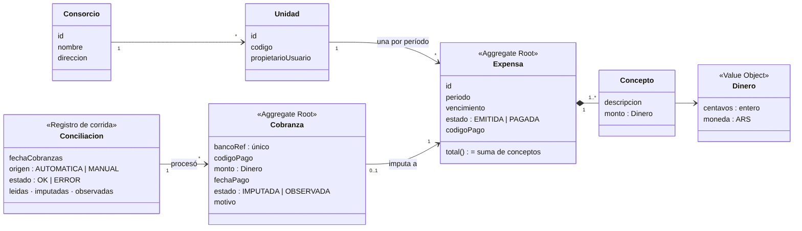
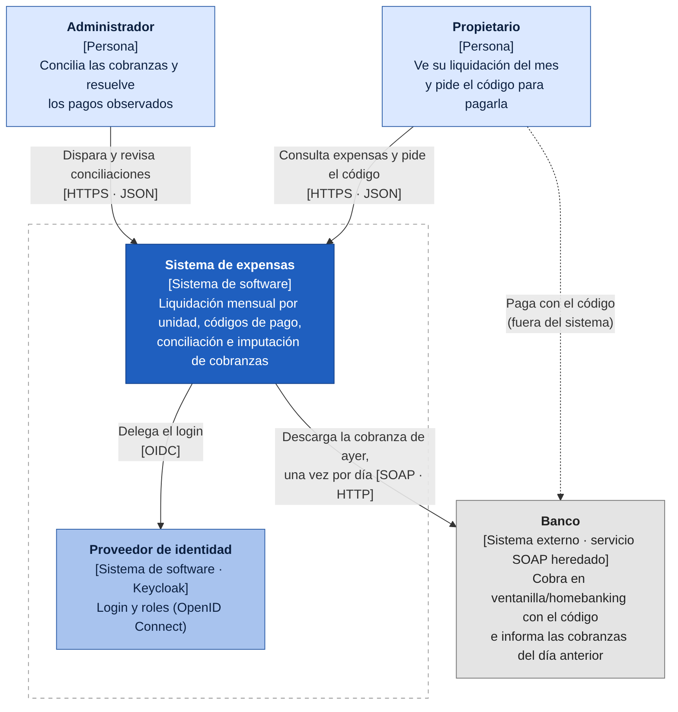
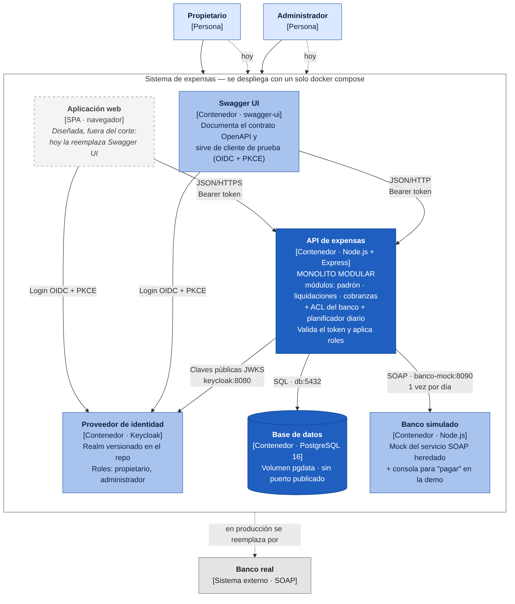
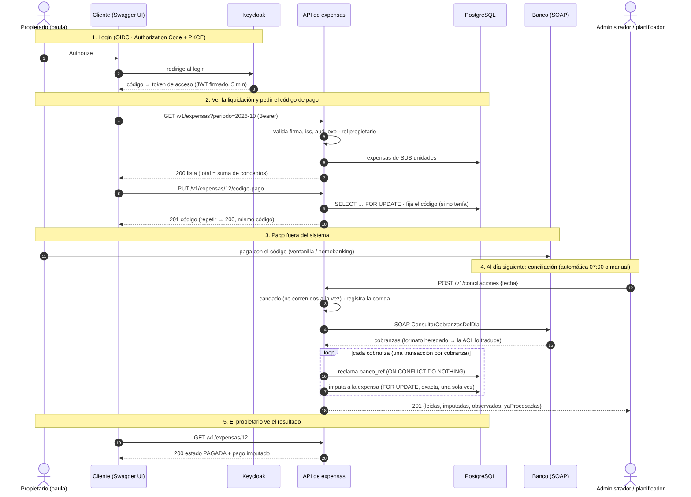

# Sistema de expensas de consorcios — Documento de arquitectura

**Materia:** Arquitectura de Software 1 — UNAHUR · **Escenario:** 5A (expensas, administrador independiente)
**Versión:** 1.0 · **Repositorio:** ver `README.md`

> Convención de estado en las tablas: ✔ verificado con tests automáticos · ◐ resuelto por diseño, no medido · ✗ diseñado, no implementado en el corte.

---

## 1. Resumen

Sistema para que un administrador independiente liquide las expensas mensuales de 6 consorcios (~150 unidades), y para que cada propietario vea su liquidación y la pague. El banco **no cobra online**: el propietario paga con un código y cada mañana el sistema descarga la lista de cobranzas del día anterior y **concilia**, imputando cada pago a su expensa.

La arquitectura elegida es un **monolito modular** (Node.js) con **una sola base PostgreSQL**, autenticación delegada a **Keycloak (OIDC)** y un **anticorruption layer** hacia el banco (servicio SOAP heredado, simulado con un mock). Todo se despliega con un único `docker compose up`.

La decisión rectora es que el **NFR estrella es la consistencia** (no cobrar dos veces, no liquidar mal) y la **simplicidad** (lo opera un freelancer sin guardia): cada decisión se evalúa contra esas dos.

## 2. Escenario y restricciones

| Dato del escenario | Consecuencia de diseño |
|---|---|
| 6 consorcios, ~150 unidades | Carga mínima: no se justifica escalar horizontalmente ni distribuir. |
| Un programador freelance que viene "cuando hay problemas" | Pocas piezas, simples de entender y de depurar. |
| Hosting barato | Pocos contenedores, poca memoria. |
| El banco no cobra online | Flujo asincrónico: código → pago externo → conciliación al día siguiente. |
| Descarga diaria + conciliación | Proceso batch idempotente. |
| Sin guardia: si falla de noche, se arregla al día siguiente | Auto-recuperación (reintentos, catch-up, reinicio automático). |
| Servicio SOAP heredado | Capa anticorrupción. |

**Fuera de escala (no se diseña para esto):** miles de usuarios, múltiples regiones, pagos en tiempo real, alta disponibilidad 24×7. Sobredimensionar es tan incorrecto como quedarse corto.

## 3. Requerimientos

### 3.1 Funcionales
| # | Requerimiento | Actor | Estado |
|---|---|---|---|
| RF1 | Iniciar sesión (OIDC) con rol propietario o administrador | ambos | ✔ (validación del token) · ◐ login real con Keycloak |
| RF2 | Ver la liquidación del mes de mis unidades | propietario | ✔ |
| RF3 | Obtener el código de pago de una expensa | propietario | ✔ |
| RF4 | Ver todas las expensas | administrador | ✔ |
| RF5 | Descargar cobranzas del banco y conciliar (automático y manual) | administrador/sistema | ✔ |
| RF6 | Imputar el pago y marcar la expensa como pagada | sistema | ✔ |
| RF7 | Ver cobranzas observadas y corridas de conciliación | administrador | ✔ |
| RF8 | Generar la liquidación mensual (cargar conceptos) | administrador | ✗ (diseñado; el seed carga el período 2026-10) |
| RF9 | Resolver manualmente un pago observado | administrador | ✗ |
| RF10 | Interfaz web (SPA) | ambos | ✗ (reemplazada por Swagger UI) |

**Caso de uso mínimo implementado (según la consigna):** el propietario ve la liquidación del mes y la paga; el pago queda imputado.

### 3.2 No funcionales (priorizados)

| Prioridad | NFR | Métrica / criterio | Estado |
|---|---|---|---|
| ★ 1 | **Consistencia** | Una operación del banco se procesa una sola vez; una expensa tiene a lo sumo una imputación; total = suma de conceptos | ✔ (ver §12) |
| ★ 2 | **Simplicidad operativa** | Un comando levanta todo; 5 contenedores; sin cola ni broker; sin gateway | ◐ (compose validado con `config`, no ejecutado) |
| 3 | Operabilidad sin guardia | Se recupera solo de caída del banco o del proceso; reintento ≤ 30 min | ✔ lógica · ◐ reinicio por Docker |
| 4 | Seguridad | Token validado (firma/iss/aud/exp); roles; propietario sólo ve lo suyo | ✔ |
| 5 | Costo de infraestructura | Una máquina chica | ◐ Keycloak ≈ 700 MB de RAM (estimado, **no medido**) |
| 6 | Mantenibilidad | Módulos con fronteras; contrato OpenAPI verificado | ✔ contrato · ◐ fronteras por disciplina |
| 7 | Rendimiento | Lista de 150 expensas p95 < 200 ms (criterio propuesto) | ✔ (medido local: p95 ≈ 9 ms) |
| 8 | Disponibilidad | Sin SLA formal; tolera caídas nocturnas | ◐ |
| — | Escalabilidad | No es un objetivo a esta escala | — |

## 4. Dominio (DDD)

### 4.1 Lenguaje ubicuo
**Consorcio**, **Unidad** (funcional del edificio, con un propietario), **Expensa** (liquidación mensual de una unidad), **Concepto** (renglón de la expensa), **Período** (`AAAA-MM`), **Código de pago** (identifica la expensa en el banco), **Cobranza** (pago informado por el banco), **Conciliación** (corrida diaria que cruza cobranzas con expensas), **Imputar** (aplicar una cobranza a una expensa), **Observada** (cobranza que no se pudo imputar, con motivo).

### 4.2 Subdominios y contextos
| Subdominio | Tipo | Contexto / módulo |
|---|---|---|
| Liquidación de expensas y conciliación | **Core** | `liquidaciones`, `cobranzas` |
| Padrón de consorcios y unidades | Soporte | `padron` |
| Identidad y roles | Genérico | Keycloak (no se construye) |
| Banco | Externo | ACL en `integraciones/banco` |

### 4.3 Modelo

- **Expensa** (Aggregate Root): contiene sus **Conceptos**. Su **total no se guarda**: es la suma de sus conceptos.
- **Dinero** (Value Object): centavos enteros + moneda ARS.
- **Cobranza** (Aggregate Root): identificada por `bancoRef` único; apunta a lo sumo a una expensa.
- **Conciliación**: registro de cada corrida (auditoría), no un agregado de negocio.

### 4.4 Invariantes
1. El total de una expensa es la suma de sus conceptos (por construcción).
2. Todo concepto tiene monto positivo.
3. Una operación del banco (`bancoRef`) se procesa una sola vez.
4. Una expensa tiene a lo sumo **una** cobranza imputada.
5. Sólo se imputa un pago de **monto exacto**; cualquier otro queda observado.
6. Una expensa pagada no admite nuevo código de pago.
7. Una unidad tiene a lo sumo una expensa por período.

## 5. C4 — Nivel 1: Contexto

El **propietario** consulta su liquidación y obtiene el código; paga **fuera del sistema** en el banco. El **administrador** dispara y revisa conciliaciones. El sistema delega el login en el **proveedor de identidad** y descarga cada día las cobranzas del **banco** por SOAP.

## 6. Matriz de Pugh

Base de comparación (**referencia, 0**): *monolito en capas con una base*. Puntaje: +1 mejor, 0 igual, −1 peor que la referencia.

| Criterio | Peso* | Monolito en capas (ref.) | **Monolito modular** | Microservicios | Orientado a eventos |
|---|---|:-:|:-:|:-:|:-:|
| Simplicidad operativa | ★ | 0 | 0 | −1 | −1 |
| Costo de infraestructura | | 0 | 0 | −1 | −1 |
| Consistencia transaccional | ★ | 0 | 0 | −1 | −1 |
| Mantenibilidad | | 0 | **+1** | −1 | −1 |
| Time-to-market | | 0 | 0 | −1 | −1 |
| Escalabilidad | | 0 | 0 | +1 | +1 |
| **Total** | | **0** | **+1** | **−4** | **−4** |

\* Los criterios ★ son los NFR estrella; la matriz es **sin ponderar** (suma simple) y, aun así, los dos criterios estrella explican la mayor parte de la diferencia.

**Lectura.** Los puntajes son juicios del equipo, no mediciones. Las alternativas distribuidas sólo ganan en escalabilidad, un criterio que el escenario no exige, y pierden en los dos NFR estrella: una imputación que cruza servicios deja de ser una transacción ACID. El monolito modular iguala a la referencia en todo y mejora la mantenibilidad (fronteras y propiedad de datos explícitas) sin costo operativo adicional. **Análisis de sensibilidad:** el resultado se invertiría sólo si la escala crece órdenes de magnitud o aparecen equipos independientes, lo cual no ocurre en el escenario. Ver ADR-001.

## 7. C4 — Nivel 2: Contenedores

| Contenedor | Tecnología | Responsabilidad | Estado |
|---|---|---|---|
| API de expensas | Node.js 22, Express 5 | Monolito modular, validación de token, planificador, ACL del banco | ✔ implementado |
| Base de datos | PostgreSQL 16 | Datos de los tres módulos; sin puerto publicado; volumen `pgdata` | ✔ |
| Proveedor de identidad | Keycloak 26.2.5 | OIDC, roles, usuarios de prueba (realm versionado) | ✔ configurado · ◐ no ejecutado aquí |
| Banco simulado | Node.js (sin dependencias) | Mock del servicio SOAP + consola de demo | ✔ |
| Swagger UI | swagger-ui | Documentación y cliente de prueba con login OIDC | ✔ configurado · ◐ no ejecutado aquí |
| Aplicación web (SPA) | — | Interfaz de usuario | ✗ diseñado, fuera del corte |

### Módulos de la API y propiedad de datos
| Módulo | Dueño de | Expone (vía `index.js`) |
|---|---|---|
| `padron` | `consorcios`, `unidades` | unidades de un propietario, unidad por id, unidades por ids |
| `liquidaciones` | `expensas`, `expensa_conceptos` | listar/obtener expensas, código de pago, imputar pago |
| `cobranzas` | `conciliaciones`, `cobranzas` | conciliar, corridas, cobranzas, pago imputado, datos para el planificador |

Un módulo nunca consulta las tablas de otro. `cobranzas` pide a `liquidaciones` imputar un pago (`imputarPago`); no toca `expensas`.

## 8. Caso de uso extremo a extremo

## 9. API

Contrato completo en `openapi.yaml` (OpenAPI 3.1, navegable en Swagger UI, puerto 8080).

| Método y ruta | Rol | Descripción |
|---|---|---|
| `GET /health` | público | Estado del servicio |
| `GET /v1/expensas` | ambos | Propietario: las suyas · Administrador: todas |
| `GET /v1/expensas/{id}` | ambos (propiedad) | Detalle con conceptos, total y pago imputado |
| `PUT /v1/expensas/{id}/codigo-pago` | propietario | Código de pago (201 / 200 / 409) |
| `GET /v1/expensas/{id}/codigo-pago` | propietario | Consulta el código |
| `POST /v1/conciliaciones` | administrador | Concilia una fecha (201; 409 si hay otra en curso; 502 si el banco falla) |
| `GET /v1/conciliaciones`, `/{id}` | administrador | Historial y detalle |
| `GET /v1/cobranzas` | administrador | Cobranzas (filtra por estado/corrida) |

- **Semántica HTTP:** 200/201, 400 parámetros inválidos, 401, 403, 404, 409 conflicto, 422 fecha futura, 502 banco caído, 503 identidad no disponible.
- **Errores:** Problem Details (RFC 9457).
- **Versionado:** prefijo `/v1`. Ver ADR-007.

## 10. Seguridad
- **Autenticación:** OIDC con Keycloak, Authorization Code + PKCE (ADR-005).
- **Validación en la API:** firma, `iss`, `aud`, `exp` (ADR-006).
- **Autorización:** por rol y por propiedad del dato (un propietario recibe 403 sobre expensas ajenas).
- **Superficie:** la base de datos no publica puerto; CORS limitado al origen de Swagger UI.
- **Limitaciones (demo):** HTTP sin TLS; credenciales de prueba en el repo; Keycloak en modo desarrollo. Para producción: TLS en un proxy, secretos fuera del repo, Keycloak en modo `start` con persistencia.

## 11. Operación sin guardia
| Falla | Respuesta del sistema |
|---|---|
| Banco caído o responde error | La corrida queda `ERROR`; se reintenta cada 30 min; al volver, se pone al día en orden (ADR-009) |
| La API se reinicia o cae | `restart: unless-stopped`; al arrancar marca como interrumpidas las corridas `EN_CURSO` |
| Dos conciliaciones a la vez | Candado: la segunda recibe 409 |
| Reproceso del mismo día | Idempotente: no duplica (ADR-004) |
| Keycloak caído | Tokens con claves ya cacheadas siguen valiendo; sin claves → 503 |
| Pago que no cuadra | Queda observado con motivo; no bloquea el resto |

**No cubierto:** alertas activas, backups automáticos, monitoreo.

## 12. Verificación de NFR

**Cómo se verificó:** 39 tests automáticos (`npm test`) ejecutados contra un **PostgreSQL 16 real**, con un banco simulado real y un proveedor de identidad falso que firma tokens RS256. Resultado: **39 de 39 pasan.**

| NFR / propiedad | Evidencia | Resultado |
|---|---|---|
| Consistencia: no imputar dos veces | 6 conciliaciones simultáneas del mismo día → una sola imputación | ✔ |
| Consistencia: respaldo en la base | SQL directo intenta una segunda imputación → el índice parcial la rechaza | ✔ |
| Idempotencia | Re-ejecutar el día: 0 imputadas, N "ya procesadas" | ✔ |
| Pagos que no cuadran | Doble pago, monto distinto, código desconocido → `OBSERVADA` con motivo | ✔ |
| Invariante del total | Para las 150 expensas, total = suma de conceptos | ✔ |
| Seguridad | 401 (sin token, firma ajena, payload alterado, vencido, `aud`/`iss` incorrectos); 403 por rol y por propiedad | ✔ |
| Resiliencia al IdP | Keycloak caído: tokens con claves en caché funcionan; sin caché → 503 | ✔ |
| Resiliencia al banco | Banco caído → 502, corrida `ERROR`, reintento posterior exitoso | ✔ |
| Operabilidad sin guardia | Planificador: respeta la hora, se pone al día (tope 7 días), reintenta; corrida interrumpida se marca | ✔ |
| Contrato de API | 25 chequeos de conformidad de respuestas contra `openapi.yaml` | ✔ |
| Rendimiento | Medido **en una sola máquina, sin red**: `GET /v1/expensas` (150 filas, admin) p50 4,7 ms / p95 9,4 ms; detalle p95 6,7 ms; conciliar 100 cobranzas 283 ms; re-ejecución idempotente 78 ms | ✔ (orientativo) |

**Qué NO se pudo verificar y por qué (entorno de desarrollo sin Docker):**
- `docker compose up` completo y la construcción de las imágenes (sólo se validó `docker compose config`).
- La importación del realm de Keycloak y el login OIDC real desde Swagger UI (el JSON del realm se validó sólo sintácticamente).
- El Dockerfile multi-etapa y `docker-compose.test.yml`.
- Consumo real de memoria de los contenedores.

Estas cuatro verificaciones están listadas como pendientes para el grupo en el `README.md`.

## 13. Alcance: corte implementado vs. diseño completo
| Implementado (corte) | Diseñado, no implementado |
|---|---|
| Login OIDC con 2 roles (validación en la API) | Interfaz web (SPA) |
| Ver liquidación y obtener código de pago | Generar liquidación mensual (`POST`) |
| Conciliación automática y manual, imputación | Resolución manual de pagos observados |
| Banco simulado SOAP + ACL | Mora e intereses |
| API REST documentada, Problem Details, `/v1` | Notificaciones/alertas |
| Compose con 5 servicios | Backups automáticos, TLS, monitoreo |

## 14. Riesgos y deuda técnica
1. **RAM de Keycloak vs. hosting barato** (no medido). Mitigación posible: dimensionar el servidor con margen o reemplazar el IdP.
2. **Keycloak sin persistencia** en modo desarrollo: los usuarios creados a mano se pierden al recrear.
3. **Sin backups**: pérdida de datos si falla el disco.
4. **Sin alertas**: una falla persistente del banco pasa inadvertida hasta que alguien revise las corridas.
5. **Mock ≠ banco real**: el formato real puede tener rarezas no contempladas.
6. **Compose no ejecutado** en el entorno de desarrollo del asistente.
7. **Sin mora/intereses**: la expensa vencida no cambia su monto.

## 15. Índice de decisiones (ADR)
| ADR | Decisión |
|---|---|
| [001](adr/ADR-001-monolito-modular.md) | Monolito modular con una única base |
| [002](adr/ADR-002-postgresql-y-dinero.md) | PostgreSQL y dinero en centavos enteros |
| [003](adr/ADR-003-conciliacion-batch-soap-acl.md) | Conciliación diaria por lotes (SOAP) con ACL |
| [004](adr/ADR-004-idempotencia-y-no-cobrar-dos-veces.md) | Garantías de consistencia e idempotencia |
| [005](adr/ADR-005-keycloak-oidc-roles.md) | Keycloak (OIDC) con dos roles |
| [006](adr/ADR-006-validacion-de-token-en-la-api.md) | Validación del token en la API, sin gateway |
| [007](adr/ADR-007-api-rest-contract-first.md) | REST contract-first, OpenAPI 3.1, Problem Details |
| [008](adr/ADR-008-docker-compose-y-despliegue.md) | Docker Compose, un solo comando |
| [009](adr/ADR-009-planificador-interno-con-catch-up.md) | Planificador interno con catch-up |
