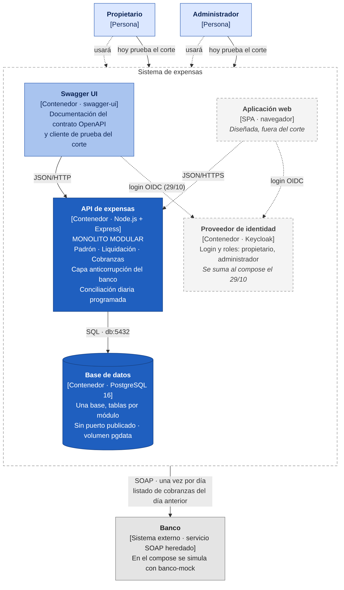
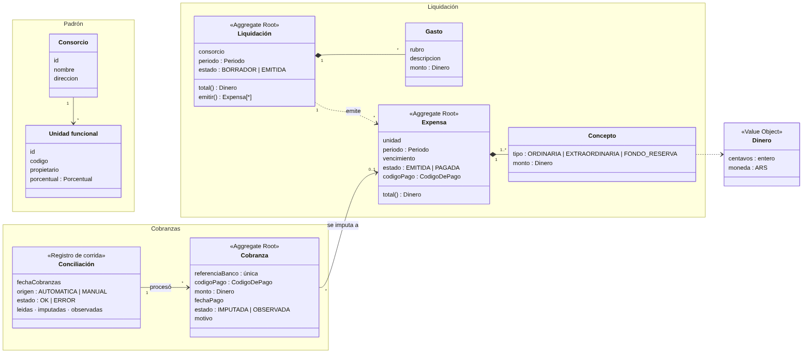

# Sistema de expensas de consorcios — Documento de arquitectura

**Arquitectura de Software 1 · UNAHUR** · Dominio 5 · Escenario **5A — Administrador independiente**

| Etapa | Contenido | Estado |
|---|---|---|
| 15/10 | Dominio y escenario, NFRs, C4 de Contexto | ✔ |
| 22/10 | Pugh, estilo, C4 de Contenedores, modelo de dominio, OpenAPI; el compose levanta | ✔ |
| 29/10 | Login con el proveedor de identidad, gateway y permisos por rol | ✔ |
| 05/11 | Caso de uso, ADRs y verificación de NFRs | Pendiente |

---

## 1. Problema y escenario

### 1.1 El problema

> Una administración de consorcios liquida cada mes las expensas de cada unidad funcional, y los propietarios las pagan. Hoy reciben transferencias y las concilian a mano, con muchos errores. Quieren que los propietarios vean su liquidación y la paguen en línea a través del banco con el que trabajan. Nunca se puede cobrar dos veces la misma expensa, y cada pago tiene que quedar imputado a la unidad correcta.
>
> — Consigna del TP, dominio 5

De la consigna surgen dos reglas que no se negocian y que guían todo el diseño:

1. **Nunca se puede cobrar dos veces la misma expensa.**
2. **Cada pago tiene que quedar imputado a la unidad correcta.**

**Situación actual:** las transferencias se concilian a mano y con errores. El sistema reemplaza esa conciliación manual.

### 1.2 El escenario 5A

| Dato del escenario (consigna) | Qué implica para el diseño |
|---|---|
| **Escala:** 6 edificios, unas 150 unidades | Escala chica: no hace falta distribuir ni escalar en horizontal. Sobredimensionar es tan grave como quedarse corto |
| **Quién lo mantiene:** un programador freelance que viene cuando hay problemas | Pocas piezas, fáciles de entender y de volver a levantar después de meses |
| **Infraestructura y presupuesto:** un hosting barato | Pocos contenedores y poca memoria |
| **NFR estrella:** consistencia y simplicidad | Son el criterio para resolver cada decisión |
| **Restricción:** el banco no cobra en línea; el propietario paga con un código y cada mañana el sistema descarga el listado de cobranzas del día anterior y las concilia | El flujo tiene tres tiempos: código de pago, pago fuera del sistema, conciliación diaria |
| **Restricción:** no hay nadie de guardia; si algo falla de noche, se arregla al otro día | El sistema tiene que recuperarse solo y no perder nada mientras tanto |
| **Roles:** propietario (ve y paga su expensa), administrador (liquida y concilia) | Dos roles, y una regla de pertenencia: cada propietario ve solo lo suyo |
| **Sistema externo:** servicio SOAP heredado del banco | Integración con un protocolo y un formato que no controlamos |
| **Caso de uso mínimo:** un propietario ve su liquidación del mes y la paga, y el pago queda imputado | Es el corte que se implementa |

### 1.3 La tensión que define el escenario

El problema pide que los propietarios paguen "en línea a través del banco", pero la restricción del escenario dice que **el banco no cobra en línea**. Esa contradicción es la que "lo cambia todo": el pago deja de ser una operación en línea y pasa a ser un flujo en tres tiempos. La pieza central del sistema es la **conciliación diaria**, que es justamente lo que hoy se hace a mano y con errores.

### 1.4 Supuestos

La consigna no los define; los declaramos para que el diseño sea verificable.

| # | Supuesto |
|---|---|
| S1 | Hay unos 150 propietarios y un administrador. El pico de uso es de decenas de usuarios simultáneos, en los días previos al vencimiento |
| S2 | El listado diario del banco trae, a lo sumo, unas pocas decenas de cobranzas |
| S3 | Los gastos los carga el administrador. Hay una liquidación por consorcio y por mes, y se trabaja con un solo banco |
| S4 | Las expensas se prorratean entre las unidades según el porcentual de cada una, fijado en el reglamento de copropiedad (agregado nuestro, fiel al dominio real) |

### 1.5 Alcance

Según la consigna, se diseña el sistema completo para la escala del escenario, pero solo se implementa el corte: **login + caso de uso mínimo**.

---

## 2. Dominio

### 2.1 Lenguaje ubicuo

| Término | Significado |
|---|---|
| **Consorcio** | Un edificio administrado |
| **Unidad funcional** | Departamento o local de un consorcio, con su propietario y su porcentual |
| **Porcentual** | Proporción de los gastos que le corresponde a una unidad, según el reglamento de copropiedad |
| **Gasto** | Erogación del consorcio en el período, clasificada por rubro (sueldos, servicios, mantenimiento, etc.) |
| **Liquidación** | Cierre del período de un consorcio: sus gastos y el prorrateo entre las unidades |
| **Expensa** | Lo que le corresponde pagar a una unidad en un período: ordinarias, extraordinarias y fondo de reserva |
| **Período** | Mes liquidado (`AAAA-MM`) |
| **Vencimiento** | Fecha límite de pago de la expensa |
| **Código de pago** | Identifica una expensa ante el banco; es lo que el propietario presenta para pagar |
| **Cobranza** | Un pago informado por el banco en el listado diario |
| **Conciliación** | Proceso diario que cruza el listado del banco con las expensas |
| **Imputación** | Aplicar una cobranza a la expensa de la unidad correcta |
| **Pago observado** | Cobranza que no se puede imputar (segundo pago de una expensa, monto distinto, código desconocido) y queda para revisión del administrador |
| **Mora** | Situación de una expensa impaga después del vencimiento |

### 2.2 Actores y roles

| Rol | Qué hace (consigna) |
|---|---|
| **Propietario** | Ve y paga **su** expensa |
| **Administrador** | Liquida y concilia |

### 2.3 Subdominios

| Subdominio | Tipo | Justificación |
|---|---|---|
| Conciliación e imputación de cobranzas | **Core** | Es el problema que hoy causa errores y donde se juegan las dos reglas innegociables |
| Liquidación y prorrateo | **Core** | Es el trabajo central del administrador; un error es plata mal cobrada |
| Padrón (consorcios, unidades, propietarios, porcentuales) | Supporting | Un ABM que sostiene a los otros dos; no es el diferencial |
| Identidad y roles | Generic | Problema resuelto: se adopta un proveedor de identidad OIDC |

### 2.4 Requerimientos funcionales

| # | Requerimiento | Rol | En el corte |
|---|---|---|---|
| RF1 | Iniciar sesión con su rol | ambos | ✔ |
| RF2 | Ver la liquidación y la expensa del mes de sus unidades | propietario | ✔ |
| RF3 | Obtener el código de pago de una expensa | propietario | ✔ |
| RF4 | Conciliar el listado de cobranzas del día anterior (automático cada mañana; manual si hace falta) | sistema / administrador | ✔ |
| RF5 | Imputar cada cobranza a la expensa y la unidad correctas | sistema | ✔ |
| RF6 | Administrar el padrón | administrador | — |
| RF7 | Liquidar el período: cargar gastos, prorratear y emitir las expensas | administrador | — |
| RF8 | Resolver los pagos observados | administrador | — |
| RF9 | Calcular mora e intereses | administrador | — |

RF1 a RF5 son el corte (login + caso de uso mínimo). RF6 a RF9 se diseñan, pero no se implementan.

---

## 3. Requerimientos no funcionales

Priorizados según el escenario 5A. Para cada uno se indica su categoría en el catálogo de NFRs, su característica en la ISO 25010 y una medida concreta. ★ marca los NFR estrella del escenario.

| Prioridad | NFR | Categoría | ISO 25010 | Qué significa en el 5A | Medida |
|---|---|---|---|---|---|
| ★ 1 | **Consistencia** | Operacional (confiabilidad) | Adecuación funcional: corrección | Nunca cobrar dos veces la misma expensa; cada pago imputado a la unidad correcta; ningún pago informado por el banco se pierde | 0 expensas con más de un pago imputado · 0 pagos imputados a una unidad equivocada · el 100 % del listado queda imputado u observado |
| ★ 1b | Consistencia de la liquidación *(agregado nuestro, supuesto S4)* | Operacional (confiabilidad) | Adecuación funcional: corrección | El prorrateo entre las unidades cuadra con el total de gastos | La suma de las expensas es igual al total liquidado, al centavo |
| ★ 2 | **Simplicidad** | Estructural (mantenibilidad, instalación) | Mantenibilidad (analizabilidad) · Portabilidad (instalabilidad) | El freelancer entiende y levanta el sistema sin ayuda, aunque no lo toque hace meses | Se levanta con un solo comando · menos de 30 minutos desde clonar el repositorio |
| 3 | Recuperación sin guardia | Operacional (recuperación, robustez) | Fiabilidad (tolerancia a fallos, recuperabilidad) | Si el banco o el servidor fallan de noche, el sistema se pone al día solo | 0 cobranzas perdidas · 0 intervenciones manuales · conciliación dentro de los 30 minutos posteriores a que el banco vuelve |
| 4 | Seguridad | Transversal (autenticación, autorización, privacidad) | Seguridad (confidencialidad) | Dos roles; cada propietario ve solo lo suyo | El 100 % de los accesos a expensas ajenas se rechaza |
| 5 | Costo | Restricción del escenario | — | Hosting barato | Todo el sistema entra en un servidor de 2 GB de RAM, medido con `docker stats` |
| 6 | Performance | Operacional | Eficiencia de desempeño | Suficiente para unas 150 unidades | Consulta de la expensa en menos de 1 s en el pico de vencimiento (supuesto S1) |
| — | Escalabilidad | Operacional | — | **No es un objetivo:** la escala es fija y chica | Se deja fuera a propósito para no sobredimensionar |

---

## 4. C4 — Nivel 1: Contexto

| Elemento | Tipo | Relación con el sistema |
|---|---|---|
| Propietario | Persona | Consulta su liquidación y obtiene el código de pago |
| Administrador | Persona | Liquida, concilia y revisa los pagos observados |
| **Sistema de expensas** | Sistema de software | Liquidación mensual por unidad, códigos de pago, conciliación diaria e imputación de cobranzas |
| Banco | Sistema externo (servicio SOAP heredado) | El sistema descarga cada mañana el listado de cobranzas del día anterior |

La línea punteada **Propietario → Banco** representa el pago con el código, que ocurre **fuera del sistema**. Es la restricción del escenario dibujada.

**Lo que no aparece en este nivel, y por qué**

- **Proveedor de identidad:** se despliega como parte del sistema, así que aparece en el C4 de Contenedores.
- **Programador freelance:** no es usuario del sistema; es a quien apunta el NFR de simplicidad.

---

## 5. Estilo arquitectónico y matriz de Pugh

### 5.1 Matriz de Pugh

Se comparan tres alternativas contra un baseline, que por definición puntúa 0 en todo. Cada alternativa se puntúa contra el baseline: +1 mejor, 0 igual, −1 peor. Los criterios salen de los NFRs priorizados en la sección 3.

**Baseline:** monolito en capas.

| Criterio (NFR de origen) | Monolito en capas (baseline) | Monolito modular | Microservicios | Orientado a eventos |
|---|:-:|:-:|:-:|:-:|
| Consistencia transaccional (★ 1) | 0 | 0 | −1 | −1 |
| Simplicidad operativa (★ 2) | 0 | 0 | −1 | −1 |
| Costo de infraestructura (5) | 0 | 0 | −1 | −1 |
| Recuperación ante fallas del banco (3) | 0 | 0 | 0 | +1 |
| Mantenibilidad: fronteras claras entre partes (★ 2) | 0 | +1 | 0 | −1 |
| Escalabilidad (no es objetivo) | 0 | 0 | +1 | +1 |
| **Total** | **0** | **+1** | **−3** | **−2** |

### 5.2 Lectura de la matriz

- **Monolito modular:** iguala al baseline en todo y mejora la mantenibilidad, porque cada módulo tiene una frontera explícita y es dueño de sus datos. Es un solo desplegable, así que no suma piezas que operar.
- **Microservicios:** pierden en los dos NFR estrella. Una imputación que hoy es una sola transacción pasaría a cruzar servicios, y habría más contenedores que desplegar y mantener para un freelancer que viene cuando hay problemas. Mejoran las fronteras, pero a costa de un sistema más difícil de seguir: queda en 0 en mantenibilidad.
- **Orientado a eventos:** tiene una ventaja real en recuperación, porque una cola persistente reintenta sola cuando el banco falla. Pero agrega un broker que operar, consistencia eventual y un flujo difícil de seguir. La ventaja en recuperación se puede obtener dentro de un monolito con reintentos e idempotencia, sin broker (ADR-004).
- **Escalabilidad:** se incluye a propósito aunque no sea un objetivo, para mostrar dónde ganarían las alternativas distribuidas y que esa ventaja no pesa en este escenario.

### 5.3 Estilo elegido

**Monolito modular con una sola base de datos** (ADR-001 y ADR-002).

---

## 6. C4 — Nivel 2: Contenedores

| Contenedor | Tecnología | Responsabilidad | Estado |
|---|---|---|---|
| Gateway | Node.js + Express | Única puerta de entrada a la API: valida el token, aplica los permisos por rol y reenvía la identidad del usuario a la API | En el compose desde el 29/10 |
| API de expensas | Node.js + Express | Monolito modular con los módulos Padrón, Liquidación y Cobranzas, la capa anticorrupción del banco y la conciliación diaria programada. Aplica la regla fina (cada propietario, lo suyo). Sin puerto publicado desde el 29/10 | En el compose desde el 22/10 |
| Base de datos | PostgreSQL 16 | Datos de los tres módulos, en tablas separadas por módulo. Sin puerto publicado, con volumen con nombre y healthcheck | En el compose desde el 22/10 |
| Swagger UI | swagger-ui | Muestra el contrato OpenAPI y sirve como cliente de prueba del corte, con login OIDC | En el compose desde el 22/10 |
| Proveedor de identidad | Keycloak | Login y roles (propietario, administrador), con el realm versionado en el repo | En el compose desde el 29/10 |
| Aplicación web | SPA en el navegador | Interfaz para propietarios y administrador | Diseñada, fuera del corte |

**Memoria de cada contenedor** (medida con `docker stats` el 29/10, con el sistema en reposo, en Docker Desktop sobre Windows):

| Contenedor | Memoria |
|---|---:|
| Proveedor de identidad (Keycloak) | 725,2 MiB |
| Base de datos (PostgreSQL) | 40,2 MiB |
| Gateway | 21,5 MiB |
| API de expensas | 14,7 MiB |
| Swagger UI | 13,5 MiB |
| Banco simulado | 9,4 MiB |
| **Total** | **824,5 MiB** |

El proveedor de identidad es el 88 % de la memoria del sistema: es el costo más alto de delegar la autenticación (ADR-005). Aun así, todo el sistema entra en un servidor de 2 GB, como pide el NFR de costo. Es una medición en reposo y sin carga, y el banco simulado no forma parte del despliegue real.

**Sistema externo:** el banco, con su servicio SOAP heredado. La API se autentica ante él con una API key (ADR-010). En el compose se simula con un servicio `banco-mock`, pero en el diagrama se muestra como externo porque no es parte del sistema.

**Decisiones reflejadas en el diagrama**

- **Sin BFF:** el esqueleto de la Clase 10 traía un BFF para una app mobile. Se elimina porque hay un solo tipo de cliente y el equipo es chico, que son justamente los casos en que un BFF no conviene.
- **La conciliación corre dentro de la API**, como una tarea programada, en lugar de un contenedor aparte (ADR-004).
- **El token se valida en un gateway** delante de la API (ADR-006). La API no publica su puerto: desde afuera solo se llega a ella a través del gateway.

---

## 7. Modelo de dominio

### 7.1 Bounded contexts y módulos

Cada bounded context es un módulo de la API:

| Módulo | Responsabilidad | Es dueño de |
|---|---|---|
| **Padrón** | Consorcios, unidades funcionales, propietarios y porcentuales | Sus tablas de consorcios y unidades |
| **Liquidación** | Gastos del período, prorrateo, emisión de expensas y códigos de pago | Sus tablas de liquidaciones, gastos, expensas y conceptos |
| **Cobranzas** | Conciliación diaria e imputación de cobranzas | Sus tablas de conciliaciones y cobranzas |

**Propiedad de los datos:** cada módulo es el único que lee y escribe sus tablas. Si otro módulo necesita un dato, se lo pide por su interfaz. Es la variante de "consolidación" aplicada a un monolito modular: un solo desplegable y una sola base, pero con dueños claros.

**Capa anticorrupción hacia el banco:** traduce el formato del servicio SOAP heredado (sus importes, fechas y códigos de error) al modelo propio, para que el vocabulario del banco no contamine el dominio (ADR-003).

### 7.2 Agregados

Los agregados se diseñan lo más chicos posible, siempre que sigan protegiendo sus invariantes.

| Agregado | Contiene | Invariantes que protege |
|---|---|---|
| **Liquidación** (raíz) | Los gastos de un consorcio en un período | Al emitirse, genera las expensas de todas las unidades en una sola transacción, y la suma de esas expensas es igual al total de gastos, al centavo |
| **Expensa** (raíz) | Conceptos, vencimiento, estado y código de pago | Su total es la suma de sus conceptos · se paga a lo sumo una vez · una expensa pagada no admite un código de pago nuevo · su monto no cambia después de emitida |
| **Cobranza** (raíz) | Referencia del banco, código, monto, fecha y estado | Cada operación del banco se procesa una sola vez · se imputa solo si el código existe y el monto es exacto; si no, queda observada con su motivo |

**Liquidación y Expensa son agregados separados.** Si la liquidación contuviera sus expensas, cada pago tendría que tomar la liquidación entera del consorcio, y dos propietarios pagando a la vez se trabarían entre sí. Separadas, la regla "la suma de las expensas es igual al total" se verifica una vez, al emitir. Después, el monto de una expensa ya no cambia (al pagarse solo cambia su estado), así que la regla se sigue cumpliendo sin bloquear la liquidación.

**Conciliación** no es un agregado de negocio: es el registro de cada corrida diaria (qué fecha se procesó, cuántas cobranzas se leyeron, imputaron u observaron, y si terminó bien o con error).

### 7.3 Value objects

| Value object | Por qué |
|---|---|
| **Dinero** | Importe en centavos enteros más la moneda (ARS). Evita errores de redondeo con decimales |
| **Período** | Mes liquidado, con formato `AAAA-MM` |
| **Código de pago** | Identifica una expensa ante el banco; incluye un dígito verificador para detectar errores de tipeo |
| **Porcentual** | Proporción de los gastos que le corresponde a una unidad |

### 7.4 Cómo se garantiza que nunca se cobre dos veces

Es el NFR estrella del escenario. La conciliación lo garantiza con varias capas, de modo que si una falla, la siguiente igual protege el invariante (ADR-007):

| Riesgo | Cómo se evita |
|---|---|
| La misma operación del banco llega dos veces (reintento, reproceso del mismo día) | Cada operación se registra por su identificador del banco, que es único en la base: la segunda vez se reconoce como "ya procesada" y no se vuelve a imputar |
| Dos conciliaciones corren al mismo tiempo | Un candado en la base permite una sola conciliación a la vez; la segunda recibe 409 |
| Dos cobranzas distintas para la misma expensa (el propietario pagó dos veces) | Se imputa la primera; la segunda queda **observada** con el motivo "pago duplicado" |
| Un pago que no coincide (monto distinto, código inexistente) | No se imputa: queda observado con su motivo para que lo revise el administrador |
| Un error en el código que intente imputar dos veces | La base lo rechaza: un índice único admite a lo sumo una cobranza imputada por expensa |

Cada cobranza se procesa en su **propia transacción**, con la expensa bloqueada mientras se imputa: una cobranza con problemas no frena a las demás, y nunca queda una expensa a medio actualizar.

**Código de pago:** se deriva del id de la expensa (10 dígitos) más un dígito verificador, así que siempre es el mismo para cada expensa y un error de tipeo se detecta. Se guarda en la base la primera vez que se pide.

---

## 8. API

El contrato completo va en `openapi.yaml` y se muestra con Swagger UI. Incluye solo los endpoints del caso de uso.

| Método y ruta | Rol | Para qué |
|---|---|---|
| `GET /v1/expensas?periodo=` | propietario / administrador | El propietario ve las expensas de sus unidades; el administrador, todas |
| `GET /v1/expensas/{id}` | propietario / administrador | Detalle de una expensa con sus conceptos y su estado |
| `PUT /v1/expensas/{id}/codigo-pago` | propietario (las suyas) / administrador | Obtiene el código de pago |
| `POST /v1/conciliaciones` | administrador | Descarga del banco el listado de una fecha y lo concilia a mano (la conciliación automática corre sola cada mañana, ADR-004) |
| `GET /v1/conciliaciones/{id}` | administrador | Resultado de una corrida |
| `GET /v1/cobranzas?estado=OBSERVADA` | administrador | Pagos observados para revisar |

**Criterios de diseño**

- **REST** sobre recursos del dominio, con los verbos y códigos de estado HTTP que corresponden.
- **Versionado en la URI** (`/v1`).
- **Errores con Problem Details** (`application/problem+json`).
- **`PUT` para el código de pago:** si el propietario reintenta (por ejemplo, porque se le cortó la conexión), tiene que recibir el mismo código y no uno nuevo. `PUT` es idempotente por definición: la primera vez crea el código (201) y las siguientes lo devuelven (200).
- **Seguridad:** todas las operaciones, salvo `/health`, requieren un token de acceso (`securitySchemes` del contrato). Los permisos de cada rol están en la sección 9.

---

## 9. Seguridad

### 9.1 Autenticación delegada

La autenticación es un subdominio **genérico**: no se construye, se adopta. Se delega en un **proveedor de identidad** que implementa OpenID Connect (Keycloak), con un realm versionado en el repositorio que se importa al levantar el sistema (ADR-005). La aplicación nunca ve las contraseñas: recibe un token de acceso firmado.

La **autorización**, en cambio, es en parte propia del dominio: el proveedor sabe quién tiene qué rol, pero qué puede hacer cada rol, y sobre qué unidades, lo decide el sistema.

### 9.2 Actores y roles

| Rol | Quién es | Usuarios de prueba |
|---|---|---|
| `propietario` | Ve y paga **su** expensa | `paula` (unidades 2B del consorcio 1 y 1A del consorcio 3), `pablo` (unidad 4C del consorcio 2) |
| `administrador` | Liquida y concilia | `adriana` |

### 9.3 Matriz de permisos

| Operación | Propietario | Administrador | Sin token |
|---|:-:|:-:|:-:|
| `GET /health` | ✓ | ✓ | ✓ (público) |
| `GET /v1/expensas` | ✓ solo las suyas | ✓ todas | 401 |
| `GET /v1/expensas/{id}` | ✓ si es suya; si no, 403 | ✓ | 401 |
| `PUT /v1/expensas/{id}/codigo-pago` | ✓ si es suya; si no, 403 | ✓ cualquiera | 401 |
| `POST /v1/conciliaciones` | 403 | ✓ | 401 |
| `GET /v1/conciliaciones/{id}` | 403 | ✓ | 401 |
| `GET /v1/cobranzas` | 403 | ✓ | 401 |

- **401:** falla la autenticación (no hay token, está vencido o su firma no es válida).
- **403:** el usuario está autenticado, pero su rol o su relación con la unidad no le permiten la operación.
- Los dos errores se devuelven en formato Problem Details.

**Por qué el administrador puede pedir el código de pago:** la mayoría de los propietarios no tiene cuenta en el sistema y recibe el código impreso en la boleta de expensas que entrega el administrador. Pedir el código no mueve dinero: solo identifica la expensa ante el banco, y siempre es el mismo para cada expensa.

### 9.4 Clientes y flujos

| Cliente | Tipo | Flujo |
|---|---|---|
| Swagger UI (cliente del corte) | Público: corre en el navegador y no puede guardar un secreto | Authorization Code con PKCE, con redirect URI exacto |
| Aplicación web (diseñada, fuera del corte) | Público | Authorization Code con PKCE |

El token de acceso dura **5 minutos** y está emitido para la audiencia `api-expensas`: un token emitido para otra aplicación no sirve en esta.

### 9.5 Dónde se valida el token

En un **gateway** que es la única puerta de entrada a la API (ADR-006). En cada pedido verifica:

1. la **firma**, con las claves públicas del proveedor de identidad (se descargan una vez y quedan en caché);
2. el **emisor** (`iss`): lo emitió nuestro proveedor;
3. la **audiencia** (`aud`): es para nuestra API;
4. el **vencimiento** (`exp`);
5. el **rol**, según la matriz de permisos.

Si el pedido pasa, el gateway lo reenvía a la API agregando la identidad del usuario (`X-Usuario` y `X-Roles`). Antes borra esos encabezados si los mandó el cliente, para que nadie pueda hacerse pasar por otro usuario.

### 9.6 La regla fina

> Un propietario solo ve y paga **sus** expensas.

El rol `propietario` no alcanza para expresarla: dice qué es el usuario, pero no de qué unidades es dueño. La resuelve la **API**, cruzando el usuario que recibe del gateway con el propietario de cada unidad, que es un dato del Padrón. Por eso esa regla no vive en el proveedor de identidad, que solo sabe quién tiene qué rol.

El usuario se identifica por su nombre de usuario (`preferred_username`), que coincide con el que guarda el Padrón. En el realm, los usuarios no pueden cambiar su nombre de usuario.

### 9.7 Seguridad en las demás capas

Autenticar y autorizar es una capa de la seguridad. Las demás se resuelven así (defensa en profundidad: cada capa asume que la anterior puede fallar):

| Capa | Decisión | ADR |
|---|---|---|
| Datos | La API se conecta con un **usuario propio** que solo puede leer y escribir sus tablas: no puede borrar tablas, crearlas ni borrar filas. El superusuario se usa solo para inicializar la base | ADR-008 |
| Sistema operativo y contenedores | Los contenedores propios corren con un **usuario sin privilegios** (no root), sobre imágenes oficiales con versión fija. Solo se publican los puertos necesarios | ADR-008 |
| Red y transporte | En producción, **TLS termina en el gateway**, con redirección a HTTPS y HSTS. En la demo no hay TLS porque todo corre en `localhost` | ADR-009 |
| Cuentas | En producción, **segundo factor (TOTP) obligatorio para el administrador**, que es quien concilia el dinero. En la demo está desactivado | ADR-009 |
| Integración con el banco | La API se autentica ante el banco con una **API key**, que vive en el `.env` | ADR-010 |
| Aplicación web | El gateway agrega headers de seguridad, el CORS solo admite el origen propio y los errores no exponen detalles internos | — |
| Secretos | Las contraseñas reales van en el `.env`, fuera del repositorio. Las de los usuarios de prueba están en el realm versionado porque son de demostración; en producción vendrían de un gestor de secretos | — |

## 10. Decisiones de arquitectura (ADRs)

| ADR | Decisión | Estado |
|---|---|---|
| [ADR-001](adr/ADR-001-estilo-monolito-modular.md) | Estilo: monolito modular | Aceptada |
| [ADR-002](adr/ADR-002-base-relacional-unica.md) | Una sola base relacional (PostgreSQL), con el dinero en centavos | Aceptada |
| [ADR-003](adr/ADR-003-integracion-banco-soap.md) | Integración con el banco: descarga diaria por SOAP con capa anticorrupción | Aceptada |
| [ADR-004](adr/ADR-004-conciliacion-diaria.md) | La conciliación diaria corre dentro de la API | Aceptada |
| [ADR-005](adr/ADR-005-proveedor-de-identidad.md) | Autenticación delegada en un proveedor de identidad OIDC (Keycloak) | Aceptada |
| [ADR-006](adr/ADR-006-validacion-en-gateway.md) | El token se valida en un gateway, que reenvía la identidad a la API | Aceptada |
| [ADR-007](adr/ADR-007-consistencia-de-la-imputacion.md) | Consistencia de la imputación y código de pago | Aceptada |
| [ADR-008](adr/ADR-008-minimo-privilegio.md) | Mínimo privilegio: usuario de base propio y contenedores sin root | Aceptada |
| [ADR-009](adr/ADR-009-tls-y-mfa.md) | TLS y segundo factor: diseñados para producción, desactivados en la demo | Aceptada |
| [ADR-010](adr/ADR-010-autenticacion-con-el-banco.md) | Autenticación con el banco mediante API key | Aceptada |

## 11. Verificación de NFRs

*Pendiente (05/11).*
