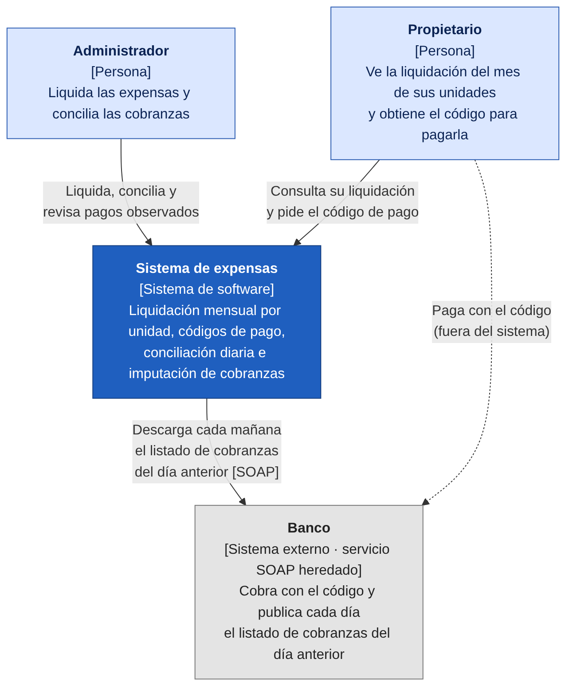

# Sistema de expensas de consorcios — Documento de arquitectura

**Arquitectura de Software 1 · UNAHUR** · Dominio 5 · Escenario **5A — Administrador independiente**

| Etapa | Contenido | Estado |
|---|---|---|
| 15/10 | Dominio y escenario, NFRs, C4 de Contexto | ✔ Este documento |
| 22/10 | Pugh, estilo, C4 de Contenedores, modelo de dominio, OpenAPI | Pendiente |
| 29/10 | Login con el proveedor de identidad | Pendiente |
| 05/11 | Caso de uso, ADRs y verificación de NFRs | Pendiente |

---

## 1. Problema y escenario

### 1.1 El problema

> Una administración de consorcios liquida cada mes las expensas de cada unidad funcional, y los propietarios las pagan. Hoy reciben transferencias y las concilian a mano, con muchos errores. Quieren que los propietarios vean su liquidación y la paguen en línea a través del banco con el que trabajan. Nunca se puede cobrar dos veces la misma expensa, y cada pago tiene que quedar imputado a la unidad correcta.
>
> — Consigna del TP, dominio 5

De la consigna surgen dos reglas que no se negocian y que guían todo el diseño:

1. **Nunca se puede cobrar dos veces la misma expensa.**
2. **Cada pago tiene que quedar imputado a la unidad correcta.**

**Situación actual:** las transferencias se concilian a mano y con errores. El sistema reemplaza esa conciliación manual.

### 1.2 El escenario 5A

| Dato del escenario (consigna) | Qué implica para el diseño |
|---|---|
| **Escala:** 6 edificios, unas 150 unidades | Escala chica: no hace falta distribuir ni escalar en horizontal. Sobredimensionar es tan grave como quedarse corto |
| **Quién lo mantiene:** un programador freelance que viene cuando hay problemas | Pocas piezas, fáciles de entender y de volver a levantar después de meses |
| **Infraestructura y presupuesto:** un hosting barato | Pocos contenedores y poca memoria |
| **NFR estrella:** consistencia y simplicidad | Son el criterio para resolver cada decisión |
| **Restricción:** el banco no cobra en línea; el propietario paga con un código y cada mañana el sistema descarga el listado de cobranzas del día anterior y las concilia | El flujo tiene tres tiempos: código de pago, pago fuera del sistema, conciliación diaria |
| **Restricción:** no hay nadie de guardia; si algo falla de noche, se arregla al otro día | El sistema tiene que recuperarse solo y no perder nada mientras tanto |
| **Roles:** propietario (ve y paga su expensa), administrador (liquida y concilia) | Dos roles, y una regla de pertenencia: cada propietario ve solo lo suyo |
| **Sistema externo:** servicio SOAP heredado del banco | Integración con un protocolo y un formato que no controlamos |
| **Caso de uso mínimo:** un propietario ve su liquidación del mes y la paga, y el pago queda imputado | Es el corte que se implementa |

### 1.3 La tensión que define el escenario

El problema pide que los propietarios paguen "en línea a través del banco", pero la restricción del escenario dice que **el banco no cobra en línea**. Esa contradicción es la que "lo cambia todo": el pago deja de ser una operación en línea y pasa a ser un flujo en tres tiempos. La pieza central del sistema es la **conciliación diaria**, que es justamente lo que hoy se hace a mano y con errores.

### 1.4 Supuestos

La consigna no los define; los declaramos para que el diseño sea verificable.

| # | Supuesto |
|---|---|
| S1 | Hay unos 150 propietarios y un administrador. El pico de uso es de decenas de usuarios simultáneos, en los días previos al vencimiento |
| S2 | El listado diario del banco trae, a lo sumo, unas pocas decenas de cobranzas |
| S3 | Los gastos los carga el administrador. Hay una liquidación por consorcio y por mes, y se trabaja con un solo banco |
| S4 | Las expensas se prorratean entre las unidades según el porcentual de cada una, fijado en el reglamento de copropiedad (agregado nuestro, fiel al dominio real) |

### 1.5 Alcance

Según la consigna, se diseña el sistema completo para la escala del escenario, pero solo se implementa el corte: **login + caso de uso mínimo**.

---

## 2. Dominio

### 2.1 Lenguaje ubicuo

| Término | Significado |
|---|---|
| **Consorcio** | Un edificio administrado |
| **Unidad funcional** | Departamento o local de un consorcio, con su propietario y su porcentual |
| **Porcentual** | Proporción de los gastos que le corresponde a una unidad, según el reglamento de copropiedad |
| **Gasto** | Erogación del consorcio en el período, clasificada por rubro (sueldos, servicios, mantenimiento, etc.) |
| **Liquidación** | Cierre del período de un consorcio: sus gastos y el prorrateo entre las unidades |
| **Expensa** | Lo que le corresponde pagar a una unidad en un período: ordinarias, extraordinarias y fondo de reserva |
| **Período** | Mes liquidado (`AAAA-MM`) |
| **Vencimiento** | Fecha límite de pago de la expensa |
| **Código de pago** | Identifica una expensa ante el banco; es lo que el propietario presenta para pagar |
| **Cobranza** | Un pago informado por el banco en el listado diario |
| **Conciliación** | Proceso diario que cruza el listado del banco con las expensas |
| **Imputación** | Aplicar una cobranza a la expensa de la unidad correcta |
| **Pago observado** | Cobranza que no se puede imputar (segundo pago de una expensa, monto distinto, código desconocido) y queda para revisión del administrador |
| **Mora** | Situación de una expensa impaga después del vencimiento |

### 2.2 Actores y roles

| Rol | Qué hace (consigna) |
|---|---|
| **Propietario** | Ve y paga **su** expensa |
| **Administrador** | Liquida y concilia |

### 2.3 Subdominios

| Subdominio | Tipo | Justificación |
|---|---|---|
| Conciliación e imputación de cobranzas | **Core** | Es el problema que hoy causa errores y donde se juegan las dos reglas innegociables |
| Liquidación y prorrateo | **Core** | Es el trabajo central del administrador; un error es plata mal cobrada |
| Padrón (consorcios, unidades, propietarios, porcentuales) | Supporting | Un ABM que sostiene a los otros dos; no es el diferencial |
| Identidad y roles | Generic | Problema resuelto: se adopta un proveedor de identidad OIDC |

### 2.4 Requerimientos funcionales

| # | Requerimiento | Rol | En el corte |
|---|---|---|---|
| RF1 | Iniciar sesión con su rol | ambos | ✔ |
| RF2 | Ver la liquidación y la expensa del mes de sus unidades | propietario | ✔ |
| RF3 | Obtener el código de pago de una expensa | propietario | ✔ |
| RF4 | Conciliar el listado de cobranzas del día anterior (automático cada mañana; manual si hace falta) | sistema / administrador | ✔ |
| RF5 | Imputar cada cobranza a la expensa y la unidad correctas | sistema | ✔ |
| RF6 | Administrar el padrón | administrador | — |
| RF7 | Liquidar el período: cargar gastos, prorratear y emitir las expensas | administrador | — |
| RF8 | Resolver los pagos observados | administrador | — |
| RF9 | Calcular mora e intereses | administrador | — |

RF1 a RF5 son el corte (login + caso de uso mínimo). RF6 a RF9 se diseñan, pero no se implementan.

---

## 3. Requerimientos no funcionales

Priorizados según el escenario 5A. Para cada uno se indica su categoría en el catálogo de NFRs, su característica en la ISO 25010 y una medida concreta. ★ marca los NFR estrella del escenario.

| Prioridad | NFR | Categoría | ISO 25010 | Qué significa en el 5A | Medida |
|---|---|---|---|---|---|
| ★ 1 | **Consistencia** | Operacional (confiabilidad) | Adecuación funcional: corrección | Nunca cobrar dos veces la misma expensa; cada pago imputado a la unidad correcta; ningún pago informado por el banco se pierde | 0 expensas con más de un pago imputado · 0 pagos imputados a una unidad equivocada · el 100 % del listado queda imputado u observado |
| ★ 1b | Consistencia de la liquidación *(agregado nuestro, supuesto S4)* | Operacional (confiabilidad) | Adecuación funcional: corrección | El prorrateo entre las unidades cuadra con el total de gastos | La suma de las expensas es igual al total liquidado, al centavo |
| ★ 2 | **Simplicidad** | Estructural (mantenibilidad, instalación) | Mantenibilidad (analizabilidad) · Portabilidad (instalabilidad) | El freelancer entiende y levanta el sistema sin ayuda, aunque no lo toque hace meses | Se levanta con un solo comando · menos de 30 minutos desde clonar el repositorio |
| 3 | Recuperación sin guardia | Operacional (recuperación, robustez) | Fiabilidad (tolerancia a fallos, recuperabilidad) | Si el banco o el servidor fallan de noche, el sistema se pone al día solo | 0 cobranzas perdidas · 0 intervenciones manuales · conciliación dentro de los 30 minutos posteriores a que el banco vuelve |
| 4 | Seguridad | Transversal (autenticación, autorización, privacidad) | Seguridad (confidencialidad) | Dos roles; cada propietario ve solo lo suyo | El 100 % de los accesos a expensas ajenas se rechaza |
| 5 | Costo | Restricción del escenario | — | Hosting barato | Todo el sistema entra en un servidor de 2 GB de RAM, medido con `docker stats` |
| 6 | Performance | Operacional | Eficiencia de desempeño | Suficiente para unas 150 unidades | Consulta de la expensa en menos de 1 s en el pico de vencimiento (supuesto S1) |
| — | Escalabilidad | Operacional | — | **No es un objetivo:** la escala es fija y chica | Se deja fuera a propósito para no sobredimensionar |

---

## 4. C4 — Nivel 1: Contexto

| Elemento | Tipo | Relación con el sistema |
|---|---|---|
| Propietario | Persona | Consulta su liquidación y obtiene el código de pago |
| Administrador | Persona | Liquida, concilia y revisa los pagos observados |
| **Sistema de expensas** | Sistema de software | Liquidación mensual por unidad, códigos de pago, conciliación diaria e imputación de cobranzas |
| Banco | Sistema externo (servicio SOAP heredado) | El sistema descarga cada mañana el listado de cobranzas del día anterior |

La línea punteada **Propietario → Banco** representa el pago con el código, que ocurre **fuera del sistema**. Es la restricción del escenario dibujada.

**Lo que no aparece en este nivel, y por qué**

- **Proveedor de identidad:** se despliega como parte del sistema, así que aparece en el C4 de Contenedores.
- **Programador freelance:** no es usuario del sistema; es a quien apunta el NFR de simplicidad.

---

## 5. Estilo arquitectónico y matriz de Pugh

*Pendiente (22/10).*

## 6. C4 — Nivel 2: Contenedores

*Pendiente (22/10).*

## 7. Modelo de dominio

*Pendiente (22/10): agregados, entidades, value objects e invariantes.*

## 8. API

*Pendiente (22/10): contrato OpenAPI del caso de uso.*

## 9. Seguridad

*Pendiente (29/10): proveedor de identidad, roles y matriz de permisos.*

## 10. Decisiones de arquitectura (ADRs)

*Pendiente (05/11).*

## 11. Verificación de NFRs

*Pendiente (05/11).*
