# Verificación manual de los NFRs

Guía de pruebas manuales sobre el sistema levantado con `docker compose`. Cada prueba indica qué NFR verifica, los pasos, el resultado esperado y el obtenido. Las capturas están en [`verificacion/`](verificacion/), con el número de la prueba al principio del nombre (por ejemplo `Prueba-1a.png`).

## Resumen

| # | NFR | Prueba | Responsable | Resultado |
|---|---|---|---|---|
| 1 | ★1 Consistencia | Pago con el monto exacto: la expensa queda pagada | Nicolás | ✔ |
| 2 | ★1 Consistencia | Reprocesar el mismo día no duplica nada | Nicolás | ✔ |
| 3 | ★1 Consistencia | Monto distinto: la cobranza queda observada | Nicolás | ✔ |
| 4 | ★1 Consistencia | Código inexistente: la cobranza queda observada | Nicolás | ✔ |
| 5 | ★1 Consistencia | Dos pagos de la misma expensa: el segundo queda observado | Nicolás | ✔ |
| 6 | ★1 Consistencia | Varias conciliaciones al mismo tiempo | Nicolás | ✔ |
| 7 | ★1b Liquidación cuadra | El total de la expensa es la suma de sus conceptos | Nicolás | ✔ |
| 8 | 3 Recuperación sin guardia | Banco caído en una conciliación manual, y reintento | Nicolás | ✔ |
| 9 | 3 Recuperación sin guardia | La conciliación automática imputa sola | Fernando | ✔ |
| 10 | 3 Recuperación sin guardia | La conciliación automática reintenta sola si el banco falla | Fernando | ✔ |
| 11 | 3 Recuperación sin guardia | Después de días sin conciliar, se pone al día sola | Fernando | ✔ |
| 12 | 4 Seguridad | Pedido sin token | Fernando | ✔ |
| 13 | 4 Seguridad | Token adulterado | Fernando | ✔ |
| 14 | 4 Seguridad | Un propietario intenta conciliar | Fernando | ✔ |
| 15 | 4 Seguridad | Un propietario pide una expensa ajena | Fernando | ✔ |
| 16 | 4 Seguridad | Un cliente intenta hacerse pasar por otro usuario | Fernando | ✔ |
| 17 | 4 Seguridad | La API no se alcanza directo y su usuario de base no puede borrar | Fernando | ✔ |
| 18 | ★2 Simplicidad · 5 Costo | Cantidad de contenedores y consumo de memoria | Fernando | ✔ |
| 19 | 3 Recuperación sin guardia | Caída de la base de datos (resiliencia) | Fernando | ✔ |

## Preparación

| Qué | Dónde |
|---|---|
| Swagger UI (para llamar a la API) | http://localhost:8080 |
| Gateway (para las pruebas con `curl.exe`) | http://localhost:8000 |
| Consola del banco simulado (cargar pagos y simular caídas) | http://localhost:8090 |

**Usuarios:** `paula` / `paula123` y `pablo` / `pablo123` (propietarios), `adriana` / `adriana123` (administradora).

**Datos usados:**

| Expensa | Propietario | Código de pago | Total |
|---|---|---|---|
| 1 (consorcio 1, 2B) | paula | `00000000018` | $50.200,01 (`5020001` centavos) |
| 51 (consorcio 3, 1A) | paula | `00000000513` | $52.600,03 (`5260003` centavos) |
| 26 (consorcio 2, 4C) | pablo | `00000000265` | — |

**Importes:** la API informa los montos en centavos; la consola del banco los pide en pesos con coma (`5020001` centavos → `50200,01`).

**Token para `curl.exe`:** en Swagger, después de *Authorize* y de ejecutar cualquier pedido, el comando *Curl* que muestra Swagger trae `Authorization: Bearer <token>`. Se copia el token en una variable de PowerShell (dura 5 minutos):

```powershell
$T = "<token>"
```

**Arranque desde cero** (cuando la prueba lo indica): borra la base y los pagos del banco simulado.

```powershell
docker compose down -v
docker compose up -d --build
```

---

## Pruebas 1 a 8 · Consistencia, liquidación y banco caído

Se hacen en orden y sobre el mismo arranque desde cero, con la conciliación automática apagada para que no registre corridas propias mientras tanto. Los pagos y las conciliaciones son del **6/11/2026** (`2026-11-06`).

```powershell
docker compose down -v
$env:CONCILIACION_AUTOMATICA="false"; docker compose up -d --build
```

### Prueba 1 · Pago con el monto exacto

**NFR:** ★1 Consistencia

**Pasos:**
1. Arranque desde cero.
2. Como paula: `PUT /v1/expensas/1/codigo-pago`.
3. En la consola del banco: código `00000000018`, importe `50200,01`, fecha 06/11/2026.
4. Como adriana: `POST /v1/conciliaciones` con `{"fecha": "2026-11-06"}`.
5. Como paula: `GET /v1/expensas/1`.

**Resultado esperado:** el paso 2 responde 201 con el código `00000000018` (repetirlo responde 200 con el mismo código). La conciliación responde 201 con `leidas: 1`, `imputadas: 1`. La expensa queda `PAGADA` y `pagoImputado` muestra la operación del banco.

**Resultado obtenido:** 201 con el código `00000000018` e importe `5020001` centavos. La conciliación (corrida 1) respondió 201 con `leidas: 1`, `imputadas: 1`. La expensa 1 quedó `PAGADA`, con `pagoImputado` OP-0001 por `5020001` centavos.

**Captura:**

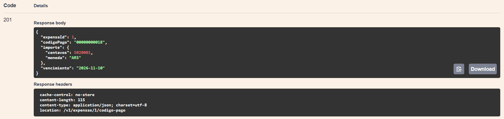

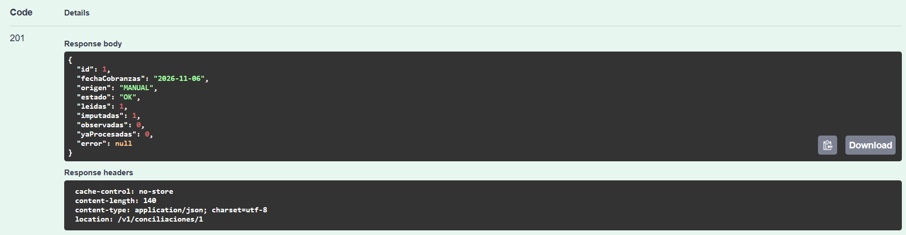

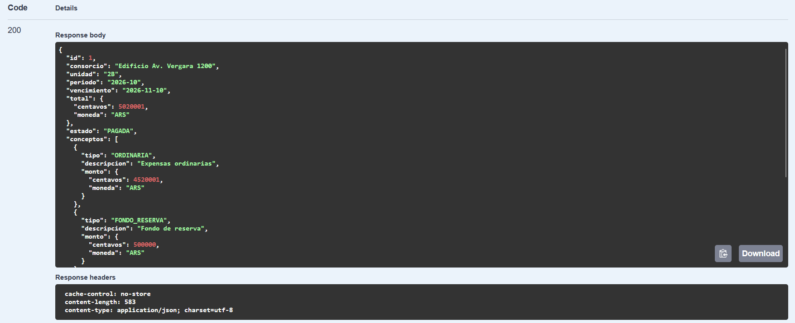

### Prueba 2 · Reprocesar el mismo día

**NFR:** ★1 Consistencia

**Pasos:**
1. Como adriana: repetir `POST /v1/conciliaciones` con la misma fecha (`2026-11-06`).
2. Como adriana: `GET /v1/cobranzas`.

**Resultado esperado:** 201 con `leidas: 1`, `imputadas: 0`, `yaProcesadas: 1`. En `/v1/cobranzas` sigue habiendo una sola cobranza imputada.

**Resultado obtenido:** Corrida 2: 201 con `leidas: 1`, `imputadas: 0`, `yaProcesadas: 1`. Sigue habiendo una sola cobranza imputada.

**Captura:**

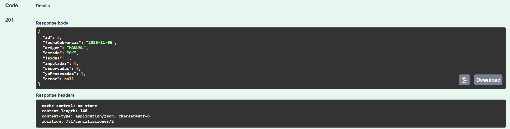

### Prueba 3 · Monto distinto

**NFR:** ★1 Consistencia

**Pasos:**
1. Como paula: `PUT /v1/expensas/51/codigo-pago`.
2. En la consola del banco: código `00000000513`, importe `1000,00`, fecha 06/11/2026.
3. Como adriana: `POST /v1/conciliaciones` con la fecha `2026-11-06`.
4. Como adriana: `GET /v1/cobranzas?estado=OBSERVADA`.
5. Como paula: `GET /v1/expensas/51`.

**Resultado esperado:** la corrida da `observadas: 1`, `yaProcesadas: 1`. La cobranza queda `OBSERVADA` con motivo `MONTO_DISTINTO`. La expensa 51 sigue `EMITIDA`.

**Resultado obtenido:** El código de la expensa 51 es `00000000513` y su total `5260003` centavos. Corrida 3: `leidas: 2`, `observadas: 1`, `yaProcesadas: 1`. La cobranza OP-0002 (`100000` centavos) quedó `OBSERVADA` con motivo `MONTO_DISTINTO`. La expensa 51 sigue `EMITIDA`.

**Captura:**

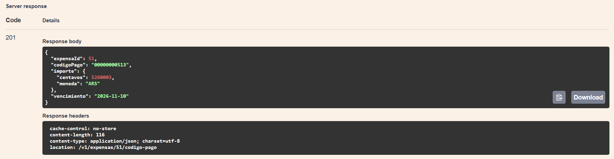

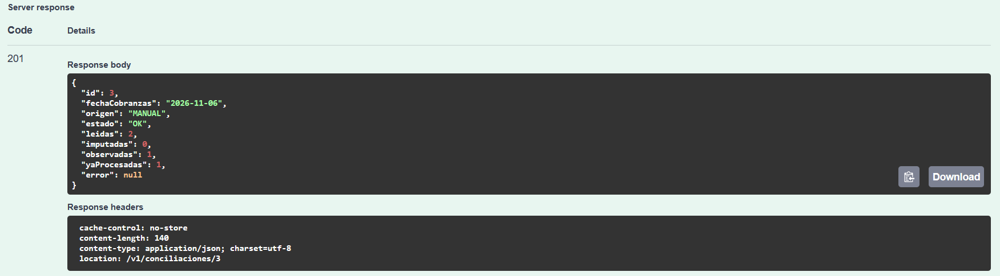

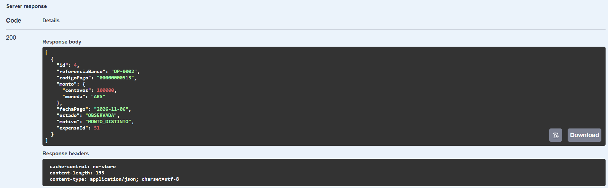

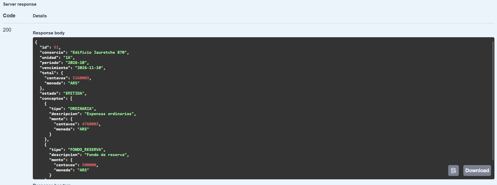

### Prueba 4 · Código inexistente

**NFR:** ★1 Consistencia

**Pasos:**
1. En la consola del banco: código `00000000017` (el de la expensa 1 con el último dígito cambiado), importe `50200,01`, fecha 06/11/2026.
2. Como adriana: `POST /v1/conciliaciones` con la fecha `2026-11-06`.
3. Como adriana: `GET /v1/cobranzas?estado=OBSERVADA`.

**Resultado esperado:** la corrida da `observadas: 1`, `yaProcesadas: 2`. La nueva cobranza queda `OBSERVADA` con motivo `CODIGO_DESCONOCIDO` y sin expensa asociada.

**Resultado obtenido:** La cobranza OP-0003 (código `00000000017`) quedó `OBSERVADA` con motivo `CODIGO_DESCONOCIDO` y `expensaId: null`.

**Captura:**

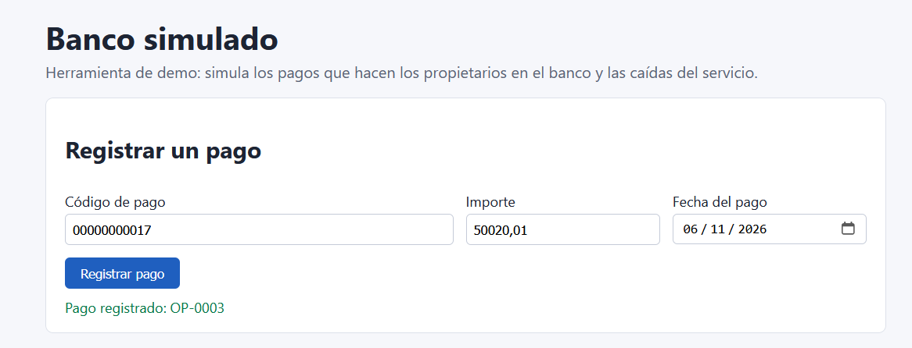

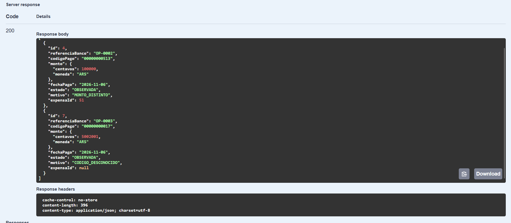

### Prueba 5 · Dos pagos de la misma expensa

**NFR:** ★1 Consistencia

**Pasos:**
1. En la consola del banco: otra vez código `00000000018`, importe `50200,01`, fecha 06/11/2026.
2. Como adriana: `POST /v1/conciliaciones` con la fecha `2026-11-06`.
3. Como adriana: `GET /v1/cobranzas`.

**Resultado esperado:** la corrida da `observadas: 1`, `yaProcesadas: 3`. La segunda cobranza queda `OBSERVADA` con motivo `PAGO_DUPLICADO`. La expensa 1 sigue con un solo pago imputado.

**Resultado obtenido:** La cobranza OP-0004 (código `00000000018`) quedó `OBSERVADA` con motivo `PAGO_DUPLICADO`. La expensa 1 sigue con un solo pago imputado (OP-0001). El pago se cargó con `50020,01`; el motivo es el mismo con el importe exacto, porque una expensa ya pagada se rechaza antes de comparar el monto.

**Captura:**

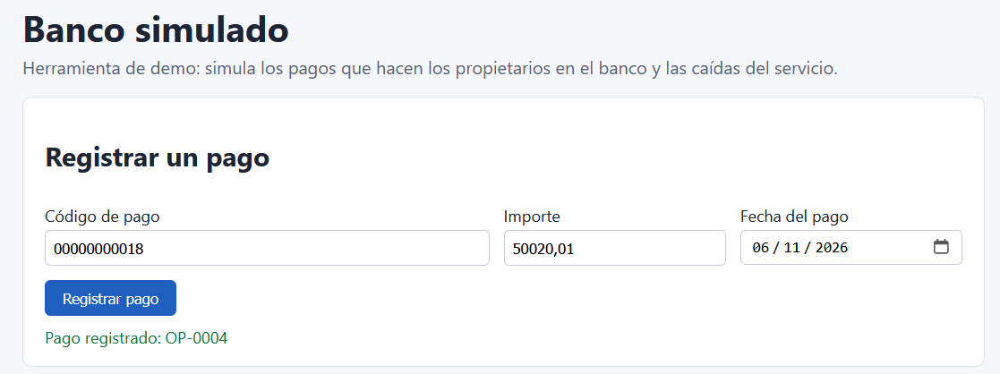

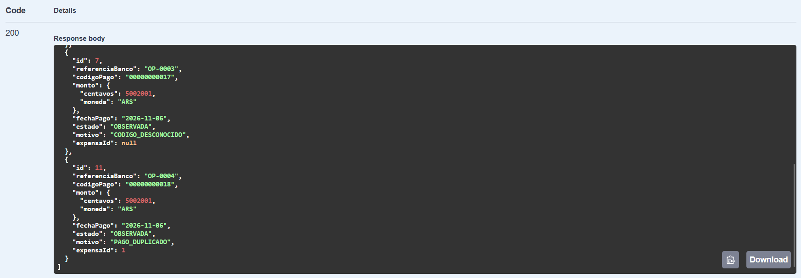

### Prueba 6 · Varias conciliaciones al mismo tiempo

**NFR:** ★1 Consistencia

**Pasos:**
1. Con el token de adriana en `$T`, desde la carpeta del repo:

```powershell
'{"fecha":"2026-11-06"}' | Out-File -Encoding ascii fecha.json
curl.exe -s --parallel --parallel-immediate -w "  -> HTTP %{http_code}`n" -X POST -H "Authorization: Bearer $T" -H "Content-Type: application/json" -d "@fecha.json" http://localhost:8000/v1/conciliaciones http://localhost:8000/v1/conciliaciones http://localhost:8000/v1/conciliaciones http://localhost:8000/v1/conciliaciones http://localhost:8000/v1/conciliaciones
Remove-Item fecha.json
```

2. Como adriana: `GET /v1/cobranzas`.

**Resultado esperado:** los pedidos que coinciden con otra conciliación en curso reciben 409 (*Conciliación en curso*). Los que corren reciben 201 con `imputadas: 0`. En `/v1/cobranzas` no aparece ninguna cobranza nueva y la expensa 1 sigue con un solo pago imputado.

**Resultado obtenido:** 4 pedidos recibieron 409 (*Conciliación en curso*) y 1 recibió 201: corrida 6 con `leidas: 4`, `imputadas: 0`, `yaProcesadas: 4`. Sigue habiendo una sola cobranza imputada.

**Captura:**

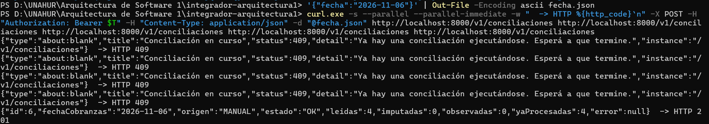

### Prueba 7 · El total es la suma de los conceptos

**NFR:** ★1b Liquidación cuadra

**Pasos:**
1. Como paula: `GET /v1/expensas/1`.

**Resultado esperado:** `total.centavos` es igual a la suma de los `monto.centavos` de `conceptos` (4.520.001 + 500.000 = 5.020.001).

**Resultado obtenido:** `total.centavos` = 5.020.001 = 4.520.001 (ordinaria) + 500.000 (fondo de reserva).

**Captura:**

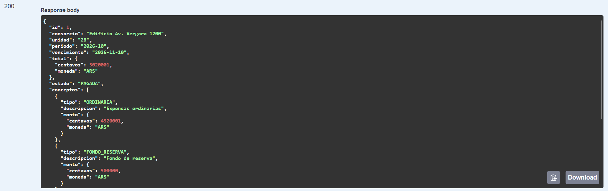

### Prueba 8 · Banco caído en una conciliación manual, y reintento

**NFR:** 3 Recuperación sin guardia

**Pasos:**
1. En la consola del banco: *Simular caída*.
2. Como adriana: `POST /v1/conciliaciones` con la fecha `2026-11-06`.
3. Como adriana: `GET /v1/conciliaciones/{id}` con el id que figura en el mensaje de error.
4. En la consola del banco: *Restablecer el servicio*.
5. Como adriana: repetir `POST /v1/conciliaciones` con la fecha `2026-11-06`.

**Resultado esperado:** el paso 2 responde 502 *Banco no disponible*, indicando que la corrida quedó registrada con error. En el paso 3 la corrida figura `ERROR` con el motivo. El reintento responde 201 `OK`, sin imputaciones nuevas.

**Resultado obtenido:** El POST respondió 502 *Banco no disponible*: "La corrida 10 quedó registrada con error y se puede reintentar". La corrida 10 (`2026-11-06`) figura `ERROR` con el motivo del banco. Con el banco restablecido, el reintento (corrida 11) respondió 201 `OK` con `leidas: 4`, `imputadas: 0`, `yaProcesadas: 4`. Las corridas 7 y 8 son de un primer intento cargado por error con la fecha `2026-06-11`; no afectan a ninguna expensa.

**Captura:**

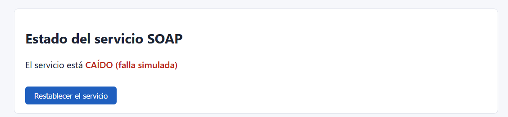

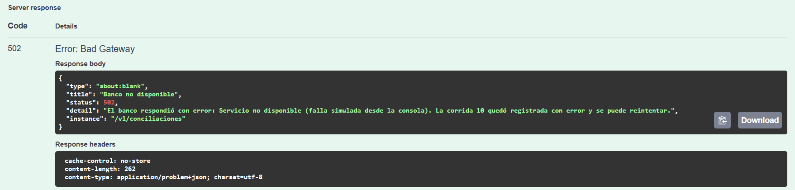

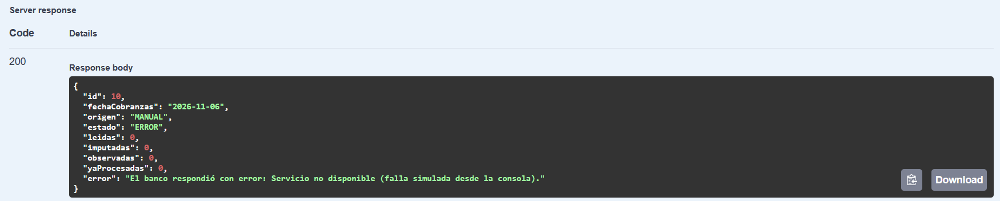

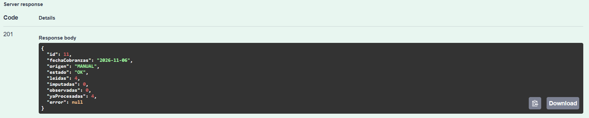

---

## Pruebas 9 a 11 · Conciliación automática

La conciliación automática corre dentro de la API desde la hora `CONCILIACION_HORA` (07:00 por defecto) y concilia hasta ayer. Para probarla sin esperar se cambian sus variables desde PowerShell; al terminar se restablecen:

```powershell
Remove-Item Env:CONCILIACION_AUTOMATICA, Env:CONCILIACION_HORA, Env:CONCILIACION_REINTENTO_MIN -ErrorAction SilentlyContinue
docker compose up -d api
```

### Prueba 9 · La conciliación automática imputa sola

**NFR:** 3 Recuperación sin guardia

**Pasos:**
1. Arranque desde cero con la automática apagada:
   ```powershell
   docker compose down -v
   $env:CONCILIACION_AUTOMATICA="false"; docker compose up -d --build
   ```
2. Como paula: `PUT /v1/expensas/1/codigo-pago`.
3. En la consola del banco: código `00000000018`, importe `50200,01`, **fecha 05/11/2026** (el día anterior).
4. Encender la automática con una hora ya pasada:
   ```powershell
   $env:CONCILIACION_AUTOMATICA="true"; $env:CONCILIACION_HORA="00:00"; docker compose up -d api
   docker compose logs api
   ```
5. Como adriana: `GET /v1/conciliaciones/1`. Como paula: `GET /v1/expensas/1`.

**Resultado esperado:** el log muestra `[conciliación automática] 2026-11-05: corrida 1 OK (1 imputadas, 0 observadas)`. La corrida tiene `origen: AUTOMATICA` y la expensa queda `PAGADA`.

**Resultado obtenido:** El código de la expensa 1 se generó con 201. El log muestra `[conciliación automática] 2026-11-05: corrida 1 OK (1 imputadas, 0 observadas)`. La corrida 1 tiene `fechaCobranzas: 2026-11-05`, `origen: AUTOMATICA`, `imputadas: 1`, y la expensa 1 quedó `PAGADA`.

**Captura:**

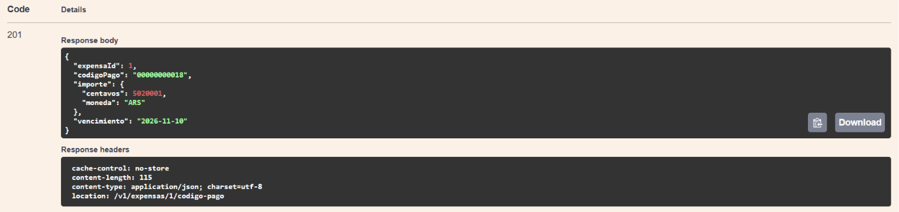

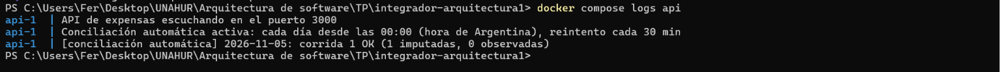

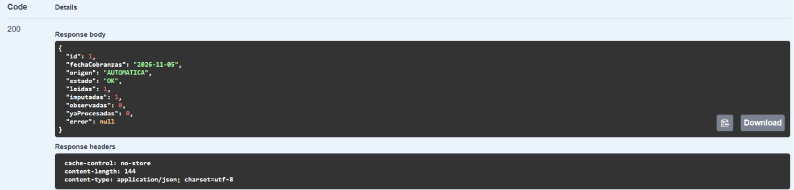

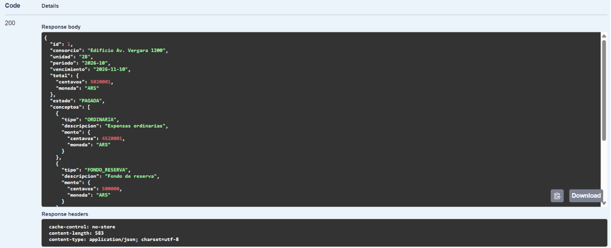

### Prueba 10 · La conciliación automática reintenta sola si el banco falla

**NFR:** 3 Recuperación sin guardia

**Pasos:**
1. Repetir los pasos 1 a 3 de la prueba 9.
2. En la consola del banco: *Simular caída*.
3. Encender la automática con reintento cada 1 minuto:
   ```powershell
   $env:CONCILIACION_AUTOMATICA="true"; $env:CONCILIACION_HORA="00:00"; $env:CONCILIACION_REINTENTO_MIN="1"; docker compose up -d api
   docker compose logs api
   ```
4. En la consola del banco: *Restablecer el servicio*.
5. Esperar 2 minutos y volver a mirar `docker compose logs api`.

**Resultado esperado:** primero el log muestra el error del banco y `Se reintenta en 1 minutos`. Después de restablecer el banco, sin intervención, aparece `corrida 2 OK (1 imputadas, 0 observadas)`. La corrida 1 queda `ERROR` y la 2 `OK`, ambas del `2026-11-05` con `origen: AUTOMATICA`.

**Resultado obtenido:** Con el banco caído, el log muestra el error y `La corrida 1 quedó registrada con error y se puede reintentar. Se reintenta en 1 minutos.` Después de restablecer el banco, sin intervención, aparece `2026-11-05: corrida 2 OK (1 imputadas, 0 observadas)`.

**Captura:**

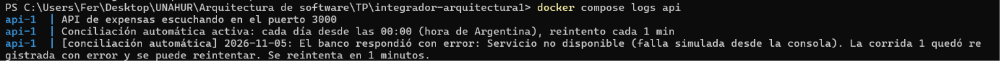

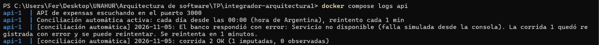

### Prueba 11 · Después de días sin conciliar, se pone al día sola

**NFR:** 3 Recuperación sin guardia

**Pasos:**
1. Arranque desde cero con la automática apagada (paso 1 de la prueba 9).
2. Como adriana: `POST /v1/conciliaciones` con `{"fecha": "2026-11-02"}`. Así la última conciliación del sistema es del 02/11.
3. Encender la automática con una hora ya pasada (paso 4 de la prueba 9) y mirar `docker compose logs api`.

**Resultado esperado:** la automática concilia sola los días que faltan, uno por uno y en orden: `2026-11-03`, `2026-11-04` y `2026-11-05`, todos `OK`.

**Resultado obtenido:** La conciliación manual del `2026-11-02` respondió 201 (corrida 1). Al encender la automática, concilió sola los días que faltaban, en orden: `2026-11-03: corrida 3 OK`, `2026-11-04: corrida 4 OK`, `2026-11-05: corrida 5 OK`.

**Captura:**

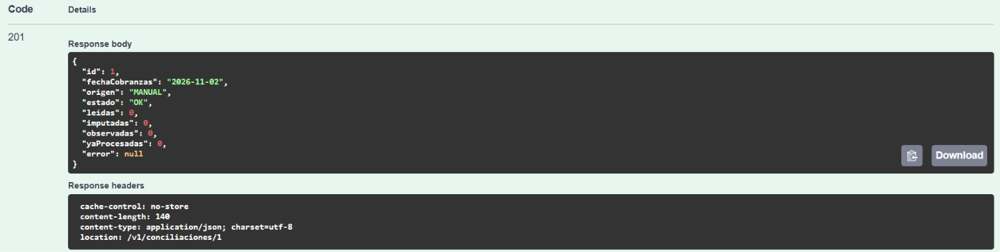

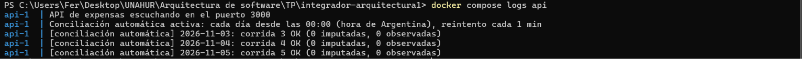

---

## Pruebas 12 a 18 · Seguridad, simplicidad y costo

### Prueba 12 · Pedido sin token

**NFR:** 4 Seguridad

**Pasos:**

```powershell
curl.exe -i http://localhost:8000/v1/expensas
```

**Resultado esperado:** 401, con el detalle del error en formato Problem Details.

**Resultado obtenido:** 401 *No autenticado*, con `WWW-Authenticate: Bearer realm="expensas"` y el detalle `Falta el header "Authorization: Bearer <token>"`. La respuesta trae los headers de seguridad del gateway (`nosniff`, CSP, `no-referrer`, `no-store`).

**Captura:**

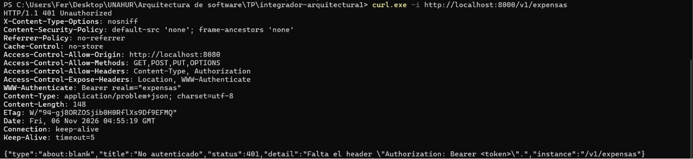

### Prueba 13 · Token adulterado

**NFR:** 4 Seguridad

**Pasos:** con el token de paula en `$T`, se cambian los últimos caracteres (la firma):

```powershell
$T2 = $T.Substring(0, $T.Length - 4) + "AAAA"
curl.exe -i -H "Authorization: Bearer $T2" http://localhost:8000/v1/expensas
curl.exe -i -H "Authorization: Bearer $T" http://localhost:8000/v1/expensas
```

**Resultado esperado:** con el token adulterado, 401. Con el original, 200.

**Resultado obtenido:** Con el token adulterado, 401 con `Token inválido (ERR_JWS_SIGNATURE_VERIFICATION_FAILED)`. Con el token original, 200 con las expensas de paula (1 y 51).

**Captura:**

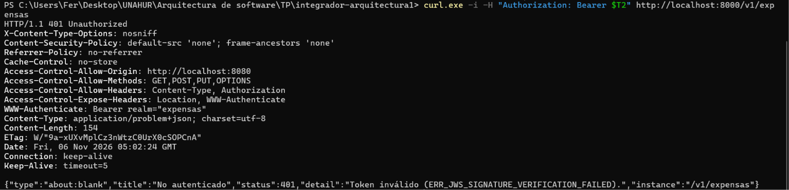

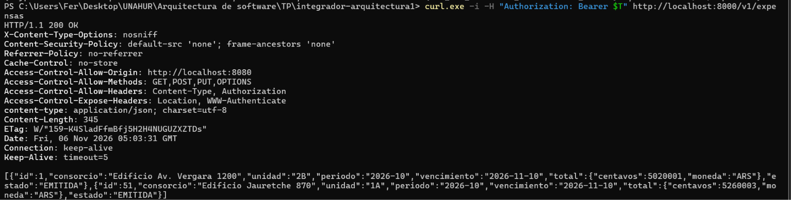

### Prueba 14 · Un propietario intenta conciliar

**NFR:** 4 Seguridad

**Pasos:**
1. Como paula: `POST /v1/conciliaciones` con `{"fecha": "2026-11-06"}`.

**Resultado esperado:** 403. El pedido lo frena el gateway y no llega a la API.

**Resultado obtenido:** 403 *Sin permiso*: `paula tiene los roles [propietario] y esta operación requiere uno de [administrador]`.

**Captura:**

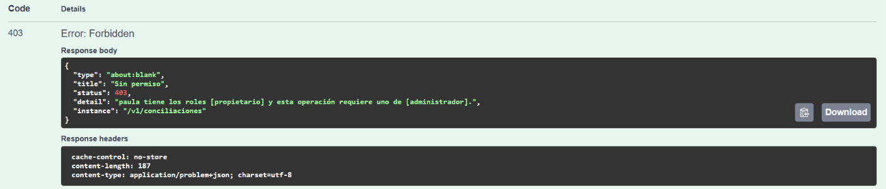

### Prueba 15 · Un propietario pide una expensa ajena

**NFR:** 4 Seguridad

**Pasos:**
1. Como paula: `GET /v1/expensas/26` (es de pablo) y `PUT /v1/expensas/26/codigo-pago`.
2. Como paula: `GET /v1/expensas/1` (es suya).

**Resultado esperado:** 403 en los pedidos sobre la expensa 26; 200 en la expensa 1. Esta regla la aplica la API, porque depende de quién es el propietario de cada unidad.

**Resultado obtenido:** `GET /v1/expensas/26` y `PUT /v1/expensas/26/codigo-pago` respondieron 403 con `La expensa 26 no pertenece a una unidad de paula`. `GET /v1/expensas/1` respondió 200.

**Captura:**

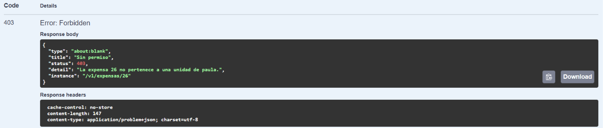

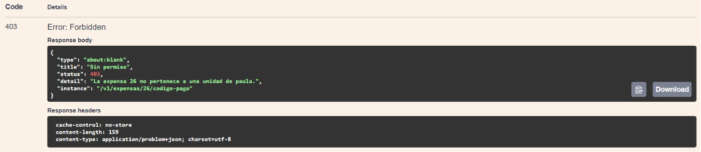

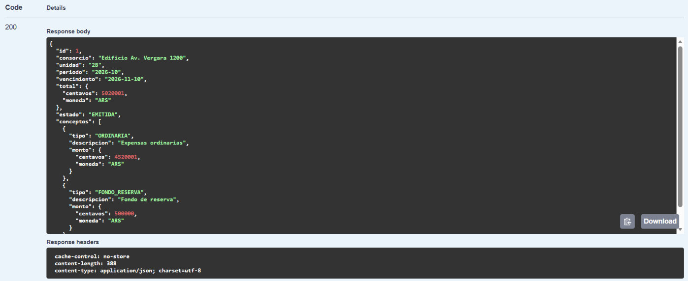

### Prueba 16 · Un cliente intenta hacerse pasar por otro usuario

**NFR:** 4 Seguridad

**Pasos:** con el token de pablo en `$T`, se pide la expensa de paula mandando además los headers de identidad:

```powershell
curl.exe -i -H "Authorization: Bearer $T" -H "X-Usuario: paula" -H "X-Roles: administrador" http://localhost:8000/v1/expensas/1
```

**Resultado esperado:** 403. El gateway descarta los `X-Usuario` y `X-Roles` que manda el cliente y pone los del token (pablo).

**Resultado obtenido:** 403 con `La expensa 1 no pertenece a una unidad de pablo`: el gateway ignoró los headers `X-Usuario: paula` y `X-Roles: administrador` y usó la identidad del token.

**Captura:**

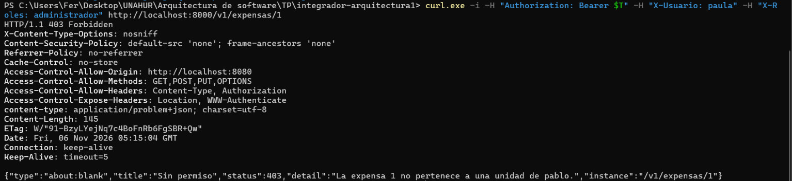

### Prueba 17 · La API no se alcanza directo y su usuario de base no puede borrar

**NFR:** 4 Seguridad

**Pasos:**

```powershell
curl.exe http://localhost:3000/health
docker compose exec db psql -U api_expensas -d expensas -c "DELETE FROM cobranzas;"
docker compose exec db psql -U api_expensas -d expensas -c "SELECT count(*) FROM cobranzas;"
```

**Resultado esperado:** el primer comando no puede conectarse (la API no publica su puerto). El `DELETE` falla con `permission denied for table cobranzas`. El `SELECT` funciona.

**Resultado obtenido:** `curl` no pudo conectarse a `localhost:3000` (*Could not connect to server*). El `DELETE` falló con `permission denied for table cobranzas`. El `SELECT` funcionó.

**Captura:**

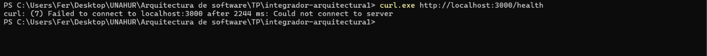

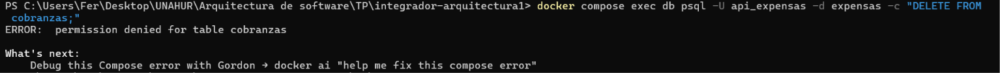

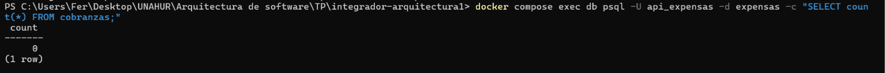

### Prueba 18 · Cantidad de contenedores y consumo de memoria

**NFR:** ★2 Simplicidad · 5 Costo

**Pasos:**

```powershell
docker compose ps
docker stats --no-stream
```

**Resultado esperado:** 6 contenedores en ejecución (db, api, gateway, keycloak, banco-mock, swagger-ui). Se anota la memoria de cada uno y el total.

**Resultado obtenido:** 6 contenedores en ejecución: api 25,5 MiB, gateway 22,4 MiB, keycloak 634,4 MiB, db 29,9 MiB, banco-mock 9,6 MiB y swagger-ui 7,9 MiB. Total: unos 730 MiB.

**Captura:**

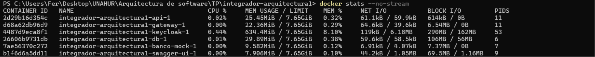

---

## Pruebas 19 en adelante · Etapa final

### Prueba 19 · Caída de la base de datos (resiliencia)

**NFR:** 3 Recuperación sin guardia (escenario E5)

Se rompe un componente a propósito y se observa qué hace el sistema.

**Hipótesis:** si la base de datos se cae, la API sigue viva y responde un error claro (503) en lugar de un error interno o de quedar colgada. Cuando la base vuelve, el sistema funciona de nuevo sin reiniciar la API y sin haber perdido datos.

**Pasos:**

1. **Estado estable.** Con el sistema levantado (`docker compose up -d --build`), como paula en la interfaz web (http://localhost:3001) se ven sus expensas y su estado, y:
   ```powershell
   curl.exe -i http://localhost:8000/health
   ```
2. **Inyectar la falla:**
   ```powershell
   docker compose stop db
   ```
3. **Observar:**
   ```powershell
   curl.exe -i http://localhost:8000/health
   docker compose ps
   docker compose logs api --tail 5
   ```
   Y en la interfaz web, como paula, recargar la lista de expensas (cambiar el filtro de estado alcanza).
4. **Restaurar:**
   ```powershell
   docker compose start db
   ```
   Esperar unos segundos a que `docker compose ps` muestre la base como `healthy`, y repetir `curl.exe -i http://localhost:8000/health` y la lista de expensas en la interfaz, **sin reiniciar la API**.

**Resultado esperado:** en el estado estable, `/health` responde 200. Con la base caída, `/health` responde **503 *Base de datos no disponible*** con `Retry-After: 30`; la interfaz muestra el aviso "Base de datos no disponible"; `docker compose ps` muestra la API en ejecución (no se cayó) y el log registra `[db] base no disponible`. Al volver la base, `/health` responde 200 y las expensas se ven igual que antes, con el mismo estado: no se perdió ningún dato.

**Resultado obtenido:** en el estado estable, `/health` responde 200. Con la base caída, `/health` responde **503 *Base de datos no disponible*** con `Retry-After: 30`; la interfaz muestra el aviso "Base de datos no disponible"; `docker compose ps` muestra la API en ejecución (no se cayó) y el log registra `[db] base no disponible`. Al volver la base, `/health` responde 200 y las expensas se ven igual que antes, con el mismo estado: no se perdió ningún dato.

**Captura:**

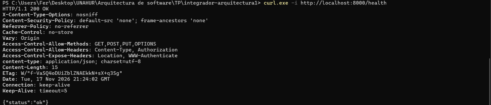

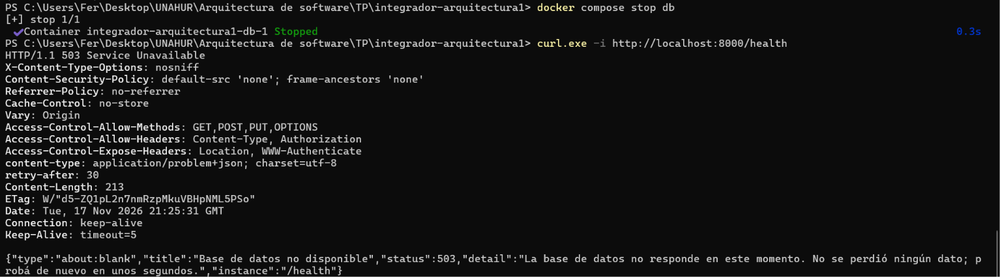

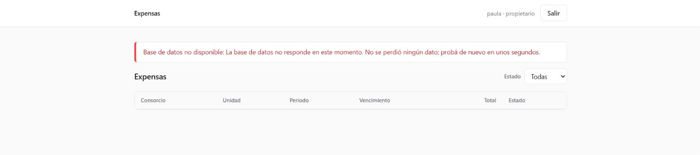

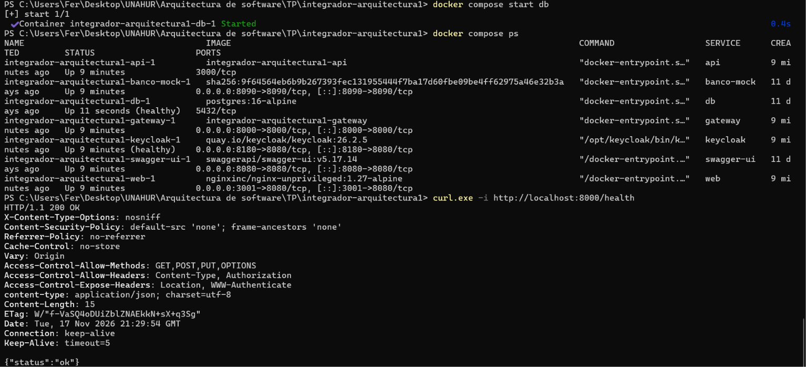

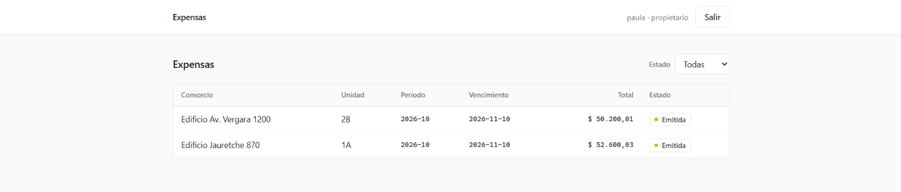